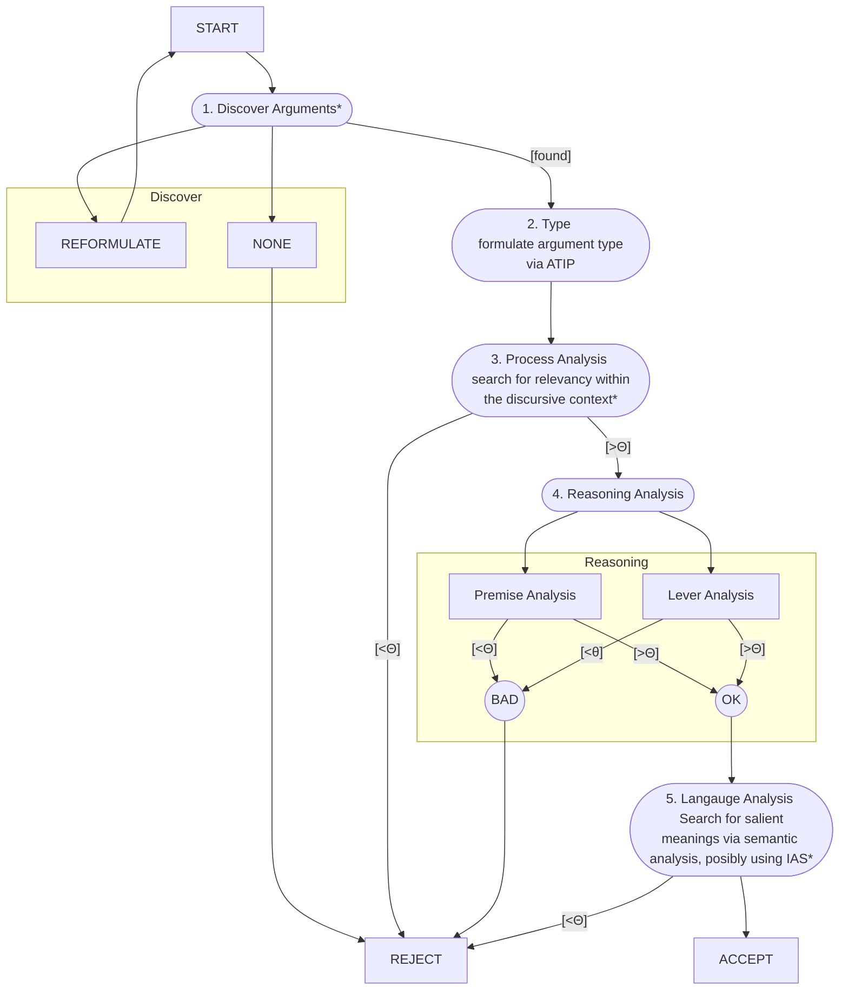

Items marked `*` do not have solid procedures yet identified.

\*1: We have identified a possible analysis procedure @pta-document-analysis.typ
\*3: NLP models could potentially do this? That or, use the train of subject/predicate analysis and pre-written embeddings to check for relevancy using a simple model -- are the subjects related, are levers related, are the predicates adjacent?
\*5: Needs more research

We route the dialogue to the relevant response based on data mined from user input.
Example variables in laya schema:

State: possibly xAIF?

Questions:

```jsonc
{
  "next_dialogue": {
    "type": "choice",
    "instructions": "Which dialogue response most naturally follows?",
    "criteria": {
      "node-name": "node summary",
      // ...
    },
  },
}
```

The dialogue choice would be fine-tuned.
-> See here:
https://github.com/NandhaKishorM/laya/blob/main/notebooks/laya_finetune_typed_decisions_2xT4_kaggle.ipynb
--> fine-tuning example based on this:
https://huggingface.co/datasets/LocalLLaMA/typed-decisions
-> DOES require both sets, obviously. Some fine-tuners say that the low hundreds
is plenty of data. Even that much will need to be mocked.

---

On reasoning analysis:

Recall that arguments have these forms.

| type | form |
| ɑ | a is X BECAUSE a is Y |
| β | a is X BECAUSE b is X |
| Ɣ | a is X BECAUSE b is Y |
| δ | p is [A/U] BECAUSE p is Z |

Subjects have these forms

| form | description |
| F | A fact - what can be objectively seen or measured and disproven by counterexample |
| V | A value or judgment of any kind, including logical judgment |
| P | A policy - what one ought to do |

A fact can be prepended with "It is an observable fact that..."
- > It is an observable fact that unauthorized downloading does not deprive the original owner of the use of an object.

A value can be prepended with "I have judged that ..."
- > I have judged that circumcising newborn children violates their right to self-determination.

A policy can be prepended with "One ought \[not] to..."
Policy prepending is tricky, because the policies often take the form of factual statements or commands, and the pronoun changes depending on the scope of the policy.
- > Go to your room. -> You ought to go to your room.
- > Some people ought to be given placebos for the experiment to go right.
- > Cycling on the grass is prohibited -> One ought not to cycle on the grass.

Running examples:

1. ɑ VF

> Unauthorized downloading (a) is not theft (X) (V)(u)
> BECAUSE
> Unauthorized downloading (a) does not deprive the original owner of the use of an object (Y) (F)(u)

2. β ss Sim

> Cycling on the grass (a) is prohibited (X) (P)(s)
> BECAUSE
> Walking on the grass (b) is prohibited (X) (P)(s)

3. Ɣ i Int

> Evil (a) will never beat good (X) (V)(u)
> BECAUSE
> defeating evil (b) is easier than defeating good (Y) (V)(u)
>
> > ALT READING: ɑ VV -- but nothing there fits, and the rewording is awkward at best.
> > Perhaps as a rule of thumb: if it's a gerund ('defeating') then it's part of the subject
> > Evil / will never beat good BECAUSE evil / is easier to defeat than good
> > but if we were presented with this as our original form ... then what?
> > perhaps it would be best to avoid a step-by-step procedure and instead
> > proceed from statistical examples.

4. δ

> We only use 10% of our brains (q)(F)(u)
> BECAUSE
> (q) was said by Einstein (Z)(F)(s)

5. ɑ PV

> Circumcising new-born children (a) should not be done (X) (P)(u)
> BECAUSE
> circumcising new-born children (a) violates their right to self-determination (Y) (V)(u)

Risk: Nearly everything can be transformed into alpha FF if you passivize it, and if you consider proof widely enough. If you are allowed to introduce intermediate propositions as in gamma d, then you can basically do anything.

## Premise analysis

Analyze the propositional content of the premise, that is, the subject and predicate. This takes the form, "⊨ Xa ?". Branches based on the type of the subject:

| type | question | example |
| --- | --- | --- |
| F | Is it true that (a)? | Is it true that we only use 10% of our brains? |
| V | Is (a) a valid judgment? | Is the statement, "circumcising newborn children violates their right to self-determination" a valid judgement? |
| P | Is the policy which comports (a) worth following? | Is "no walking on the grass" a policy worth following? |

Note that an alternate reading of the grass example could lead to a FF analysis
rather than a PP analysis. The crux is this: are we asking what is true of the
world, or what ought to be done? Namely, we could reword the argument: "The
policy prohibits cycling on the grass BECAUSE the policy prohibits walking on
the grass." This becomes alpha FF, but at the expense of changing the subject.
Changing the subject is a prohibited transformation so this doesn't work, even
though the underlying meaning may be equivalent, semantically. Other
semantically equivalent transformations exist, but again they result in changing
the subjects from "cycling" and "walking" to "the policy," which is a prohibited
transformation.

> ![KEY POINT] What transformations are prohibited during canonicalization?


## Lever analysis

Analyze the strength of the lever. This is based on the lever, which is often a
hidden premise.

| type | question |
| --- | --- |
| ɑ | ⊨ YRX ? |
| β | ⊨ aRb ? | 
| Ɣ | ⊨ ∃R.aRb = YRX ? | 
| δ | ⊨ ZAp ? (A = "is authoritative for") | 

---

## Response categories

Responses need to be based on what stage the analysis fails at, if it fails.

**Define the response categories first,** as _(stage, target, reason)_. A first cut:

| Stage      | Reason                         | Example template                                                                                                                                          |
| ---------- | ------------------------------ | --------------------------------------------------------------------------------------------------------------------------------------------------------- |
| Discover   | no argument / unclear          | "What makes you say {conclusion}?"                                                                                                                        |
| Process    | off-issue                      | "How does that bear on {issue}?"                                                                                                                          |
| Premise    | false / contradicts commitment | "Earlier you said {commitment}. Doesn't that conflict with {premise}?"                                                                                    |
| Premise    | unsupported fact (F)           | "How do we know {premise}?"                                                                                                                               |
| Premise    | contested judgement (V)        | "By what standard is {a} {Y}?"                                                                                                                            |
| Lever      | irrelevant                     | "Why would {Y} matter for {X}?"                                                                                                                           |
| Lever      | insufficient / overclaim       | "Even if {premise}, does that mean {conclusion}?"                                                                                                         |
| Lever      | family-specific                | cause: "Could something else explain {X}?" · analogy: "Isn't {a} different from {b} in a way that matters?" · authority: "Is {source} an expert on this?" |
| Conclusion | rebut                          | a counter-argument from the state                                                                                                                         |
| Language   | ambiguous / loaded term        | "What do you mean by {term}?"                                                                                                                             |

The family-specific rows come from the lever families, and Walton's critical questions are a ready source for them.

Potential extraction candidates:

```rust
enum SubjectKind {
  F, V, P
}
enum SubjectScope {
  s, p, u
}
/// for delta
enum PredicatePerson {
    I, II, III
}
/// Large enum of concepts explored within the game
/// A concept graph might connect concepts using typed 
/// edges: related, conflicts, etc. -- though this is a very
/// simplified way of mapping it out. 
enum Concept {
  Faith,
  Science,
  Argumentation,
  Authority,
  Beauty,
  //...
  
  // Not sure if this one stays.
  // Would need to judge relevance, which seems a hard problem.
  // But also opens the door for truly interesting arguments,
  // which is the point of the game.
  Other(String)
}
struct Subject {
  kind: SubjectKind,
  scope: SubjectScope,
  concept: Concept,
}
struct Statement {
  subject: string,
  predicate: string,
  span: StatementSpan,
  predicate_person: Option<PredicatePerson>
}
enum StatementSpan {
    Span(Range<u32>),
    Reconstructued,
}
/// PTA types
enum LeverKind {
    Alpha(AlphaLever),
    Beta(BetaLever),
    Gamma(GammaLever),
    Delta(DeltaLever)
}
/// Marked non-exhaustive because certain
/// combinations are invalid in the PTA.
/// Facts can only be argued from facts.
/// Values can be argued from facts or values.
/// Policies can be argued from fact, value, or policy.
/// Anything else is a bad argument.
#[non_exhaustive]
enum AlphaLever {
    // just pretend this is valid syntax lol
    FF{Cor, Ef, Cau, Sig, Inc, Mot},
    VF{ Su, Def, Cr },
    VV{ Dis, Ins, Nor },
    PF{ W, Pos, Pra },
    PV{ Ev, Pri },
    PP{ Tel, Deo }
}
enum BetaLever {
    /// sp | su | pu
    Decreasing {G, To},
    /// ps | us | up
    Increasing {Sp, Exa},
    /// ss | pp | uu
    Equal {Mi, Ma, Div, Cpo, R, Me, Eq, Cpa, Sim, A},
}
enum GammaLever {
    i{ Sy, Op, Cve, Der, Int},
    d{ Non }
}
enum DeltaLever {
    I {Eth},
    II {H, Cce, B, Car, Cse},
    III {Exp, Tes, Mor, Pop, Ig}
}

struct Lever {
  kind: LeverKind,
  statement: Statement,
}

struct Argument {
  premise: Statement,
  conclusion: Statement,
  lever: Lever,
}
impl Argument {
    fn a(&self) -> &str {
        &self.premise.subject
    }
    fn b(&self) -> &str {
        &self.conclusion.subject
    }
    fn X(&self) -> &str {
        &self.premise.predicate
    }
    fn Y(&self) -> &str {
        &self.conclusion.predicate
    }
    /// R in aRb
    fn subject_relationship(&self) -> ArgumentRelationship {
        
    }
    /// R in XRY
    fn predicate_relationship(&self) -> ArgumentRelationship {
        
    }
    /// relationship for premise analysis
    fn premise_relationship() {
        match self.lever.kind {
            LeverKind::Alpha(..) => {
                self.subject_relationship()
            },
            LeverKind::Beta(..) => {
                self.predicate_relationship()
            }
            LeverKind::Gamma(..) => {
                self.predicate_relationship().equiv(self.subject_relationship())
            }
            LeverKind::Delta(..) => {
                ArgumentRelationship::Authority
            }
        }
    }
}

// not calling these Errors because that implies
// a state failure

enum DiscoveryReason {
    NoArgument,
}
enum ProcessReason {
    Irrelevant
}
enum PremiseReason {
    /// "You're committed to {P} which contradicts {Q}"
    Commitment {statement: String },
    /// "It's just not true that {F}"
    /// Likely we have a large list of known-true things about the game world
    /// Maybe this is done via a world query...?? o.o
    Fact {statement: String},
    /// "I don't believe that {V}"
    Value {statement: String}
    /// "{P} is not a policy worth following."
    Policy {statement: String}
}

struct AnalysisScore {
    // 0-1
    score: f32,
    // 0-1,
    confidence: f32,
    reason: AnalysisReason,
}

fn premise_analysis(argument: &Argument) -> AnalysisScore; 
fn lever_analysis(argument: &Argument) -> AnalysisScore; 

```
