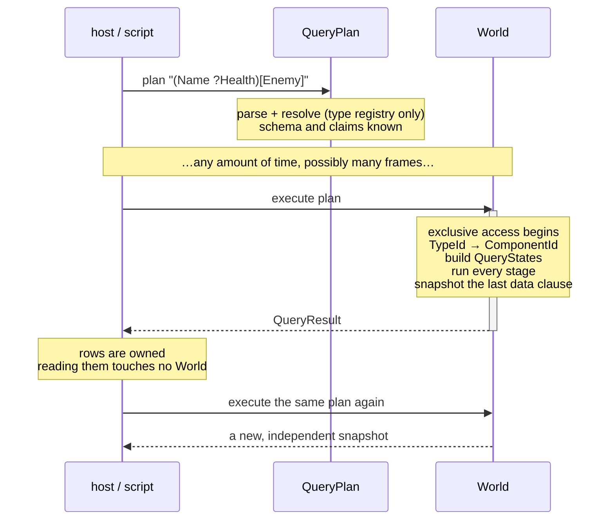
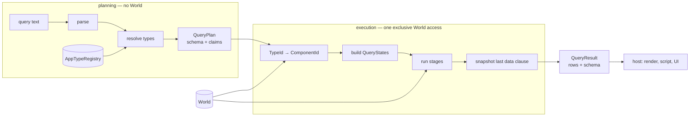
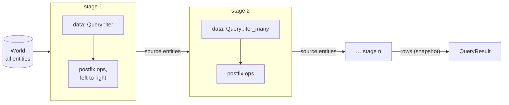
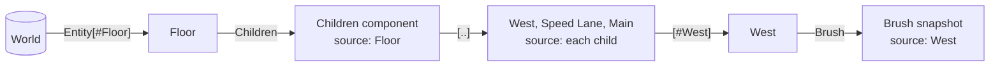

# q_query_lang

Status: **draft v0**. Once approved, supersedes `q_fs design.md`,
`q_fs grammar.md`, `lib/q_query_lang/bnf/` (grammar and validator), and
`lib/q_query_lang/.docs/plans/basic-implementation.md`.

A read-only, string-based query language over a Bevy `World`. A program is a
pipeline of Bevy-style `D[F]` queries; each stage runs over the source
entities of the previous stage's rows.

```text
(Name ?Health)[Enemy !Dead]
#Floor | Children[..][#West] | Brush
@(12v3 4v1) | (Name Transform)
```

## Grammar

ABNF over tokens. Whitespace may appear between any two tokens and is
required only where two tokens would otherwise lex as one (`A B`).

### Tokens

```abnf
IDENT      = (ALPHA / "_") *(ALPHA / DIGIT / "_")
ENTITY-ID  = 1*DIGIT "v" 1*DIGIT                ; Entity's Display: {index}v{generation}
INT        = 1*DIGIT                            ; must fit usize
STRING     = DQUOTE 1*(%x20-21 / %x23-7E) DQUOTE
punct      = "|" / "(" / ")" / "[" / "]" / "<" / ">" / "::" / ".." / "..="
           / "?" / "!" / "@" / "#"
```

`ENTITY-ID` is matched before `INT`: `12v3` is one token. Identifiers cannot
begin with a digit, so an entity id is never a type. `..=` is matched before
`..`.

`or` is reserved inside filters and nowhere else. A type named `or` must be
path-qualified in filter position (`my_crate::or`).

### Syntax

```abnf
program    = stage *("|" stage)
stage      = primary *postfix

primary    = literal / name-sel / data
literal    = "@" ENTITY-ID / "@" "(" 1*ENTITY-ID ")"
name-sel   = "#" name
data       = term / "(" 1*term ")"
term       = ["?"] type / "@"

postfix    = take / select
take       = "[" (INT / range) "]"
range      = [INT] ".." [INT] / [INT] "..=" INT ; Rust ranges
select     = "[" filter "]"

filter     = 1*or-expr                          ; juxtaposition: AND
or-expr    = unary *("or" unary)                ; binds tighter than AND
unary      = "!" unary / atom
atom       = type / "#" name / "(" filter ")"

type       = path ["<" 1*type ">"]
path       = IDENT *("::" IDENT)
name       = IDENT / STRING
```

The two bracket forms are distinguished by content: an `INT` or a range is a
**take**; anything else is a **select**. `[]` is a syntax error.

## Semantics

### Plans and results

A query exists in three forms, at three times:

| Form          | Created by          | Holds                                                   | World access     |
| ------------- | ------------------- | ------------------------------------------------------- | ---------------- |
| query text    | the user            | a string                                                | none             |
| `QueryPlan`   | planning the text   | AST, resolved `TypeId`s, output schema, read claims     | none (type registry only) |
| `QueryResult` | executing the plan  | snapshot rows of the last stage's data, plus the schema | once, during execution |

- **Planning runs nothing.** It parses and resolves types against the type
  registry. All syntax and type-resolution errors surface here. A plan is
  owned, holds no World reference, and may be stored, passed around, and
  executed any number of times.
- **Execution is atomic.** Every stage runs against one World state within a
  single exclusive World access. Stages pass only entities to each other;
  nothing is copied between stages.
- **Results are snapshots.** Only the last stage's data clause is copied, and
  only what it names: `@` copies ids, `(Name Health)` copies two components
  per row. A result is valid indefinitely and never re-reads the World.
- **Laziness lives in the plan, not in the result.** To read a value at the
  moment it is needed, execute a plan at that moment. Entity ids are the lazy
  handles: `@[Bar]` now, `@12v3 | Foo` later.



### Evaluation model

- A program evaluates its stages left to right. Its result is the last stage's
  row sequence.
- A **row** is a value plus its **source entity**. Values are an entity id, a
  component, an absent optional component, or a tuple of these.
- The source is the entity the row's data was read from. **A row whose value
  is an entity has that entity as its source**: `@`, literals, `#n`, and
  take all yield rows that are their own source.
- **The first stage runs over the world.** Every later stage runs over the
  source entities of the previous stage's rows, in order. Duplicates are
  preserved.
- A query has no other input. Hosts that want to target specific entities
  (e.g. a pointer selection) insert entity literals into the query text.
- The language is read-only. A plan records the read and filter access of
  every stage; execution never writes.



Within execution, each stage consumes entities and produces rows; only the
rows' source entities flow onward:



Worked example, `#Floor | Children[..][#West] | Brush`:



The source-entity rule is the only way stages connect. Consequently
`#e | Health | Name` is legal: it yields the `Name` of every entity named `e`
that has `Health`, equivalent to `#e | Name[Health]`. Names are not unique, so
this may be any number of entities.

### Primaries

| Form          | Yields                                             | Bevy analogue          |
| ------------- | -------------------------------------------------- | ---------------------- |
| `@12v3`       | that entity                                        | `query.get(e)`         |
| `@(12v3 4v1)` | those entities, in the written order               | `query.get_many([..])` |
| `#n`          | entities whose `Name` is `n`; sugar for `@[#n]`    | —                      |
| `T`           | `T` of each input entity that has `T`              | `Query<&T>`            |
| `?T`          | `T` or absent, for each input entity               | `Query<Option<&T>>`    |
| `@`           | sugar for `Entity`: each input entity's id         | `Query<Entity>`        |
| `(A B …)`     | one tuple row per entity matching every required term | `Query<(A, B, …)>`  |

- Entity literals are valid only in the first stage.
- A literal naming a despawned entity is an error. A literal naming an entity
  excluded by default query filters (e.g. `Disabled`) is an error that names
  the cause.
- A required term (`T`) drops entities lacking `T`; `?T` keeps them with an
  absent value.
- `Entity` is a reserved builtin, never resolved as a component. `?Entity` and
  `?@` are errors.
- Over the world, a data stage is `Query::iter`; in a later stage it is
  `Query::iter_many` over the input entities.

### Postfix operators

Postfix operators apply left to right, each to the sequence produced so far.

| Form     | Name   | Meaning                                                   |
| -------- | ------ | --------------------------------------------------------- |
| `[F]`    | select | keep rows whose **source entity** satisfies filter `F`   |
| `[..]`   | take   | follow a relationship to all related entities             |
| `[a..b]` | take   | follow it to related entities at positions `a` to `b - 1` |
| `[a..=b]`| take   | follow it to related entities at positions `a` to `b`     |
| `[n]`    | take   | follow it to the related entity at position `n`           |

**Select** tests the entity each row came from; for an entity row, that is
the row itself. `Name[Enemy]` is `Query<&Name, With<Enemy>>`. When a select
immediately follows the data, it compiles into the stage's `QueryState`;
elsewhere it is evaluated over the sequence. The results are identical.

**Take** applies to the current value of each row, which must be a single
relationship component — either side of a Bevy relationship (`Relationship`
or `RelationshipTarget`). Each row is replaced by the chosen related
entities, in relationship order; each related entity becomes the source. It
goes through `ComponentInfo::relationship_accessor()` and needs no
reflection.

- Positions are zero-based. Ranges follow Rust: `[..]`, `[a..]`, `[..b]`,
  `[a..b]` (half-open), `[a..=b]`, `[..=b]` (inclusive).
- Take is **per row**: `@[Brush] | Children[0]` is the first child of _each_
  entity, not the first child overall.
- Out of range is an empty result for that row, not an error.
- Despawned targets are skipped; Bevy does not validate entries inserted
  directly into a `RelationshipTarget`.
- Take walks the relationship directly, as iterating `Children` does in
  Bevy, so default query filters do not hide taken entities. A later
  stage's query applies them again.
- `Children[..]` yields children; `ChildOf[0]` and `ChildOf[..]` both yield
  the parent.
- Fetching and following are distinct: `Children` is the component,
  `Children[..]` is the children.
- After a take, rows are entities, so a further take is an error.
  `Children[..][Foo]` selects the children having `Foo`.
- `Children[Foo]` is a select on the **owner**:
  `Query<&Children, With<Foo>>`.

### Filters

| Form          | Meaning                       | Bevy                   |
| ------------- | ----------------------------- | ---------------------- |
| `T`           | entity has `T`                | `With<T>`              |
| `!T`          | entity lacks `T`              | `Without<T>`           |
| `#n`          | entity's `Name` is `n`        | —                      |
| `A B`         | both                          | `(A, B)`               |
| `A or B`      | either                        | `Or<(A, B)>`           |
| `(…)`         | grouping                      |                        |

- **Precedence: `or` binds tighter than juxtaposition.** `[A B or C]` is
  `A and (B or C)`; `[(A B) or C]` groups the conjunction explicitly.
- `!` applies to any atom, including groups. Negation is normalized inward
  with De Morgan's laws: `!(A B)` → `!A or !B`, `!(A or B)` → `!A !B`. Negated
  presence becomes `Without`; negated name tests are evaluated per entity.
- `Entity` in filter position is an error.

### Type resolution

- **Constraint:** a queryable type must be **reflect-registered** in
  `AppTypeRegistry` with `ReflectComponent` (`#[reflect(Component)]`).
  Opaque reflection suffices for everything except snapshotting. This
  works in every build profile, which scripts require.
- `ReflectComponent` is how planning tells components from other reflected
  types, and how execution reads a component for its snapshot.
- Resolution: query path → `TypeRegistration` (by `type_path()`) → `TypeId`
  at planning; `TypeId` → `ComponentId` via `world.components()` at
  execution.
- A path resolves by **suffix match** against reflected type paths: `Foo`
  matches any `…::Foo`; `my_crate::Foo` disambiguates. Exactly one match is
  required.
- Generic types match structurally, argument by argument, by parsing each
  registered type path with the same `type` grammar:
  `MeshMaterial3d<StandardMaterial>` matches
  `bevy_pbr::…::MeshMaterial3d<bevy_pbr::…::StandardMaterial>`.
- A reflect-registered component not yet initialized in this World is
  ordinary absence: required terms and `With` match nothing, `?T` is absent,
  `Without` matches everything, take yields nothing.

### Errors

Errors are loud; a typo never becomes an empty result. Empty results are not
errors.

Planning errors are found from the query text and the type registry alone.
Execution errors depend on World state.

| Error                       | Example                  | Phase     | Note                                        |
| --------------------------- | ------------------------ | --------- | ------------------------------------------- |
| syntax error                | `Foo[`                   | plan      | reports the byte offset                     |
| unknown type                | `Fooo`                   | plan      | a typo, or a type not reflect-registered    |
| ambiguous type              | `Foo`                    | plan      | lists every candidate path                  |
| not a component             | `Vec3`                   | plan      | no `ReflectComponent`                       |
| opaque type snapshotted     | `SomeOpaque`             | plan      | only in the final data clause               |
| duplicate tuple term        | `(Name Name)`            | plan      |                                             |
| take on a tuple or entity   | `(A B)[0]`, `#Floor[..]`, `Children[..][0]` | plan |                              |
| literal after first stage   | `Name \| @12v3`          | plan      |                                             |
| reserved `Entity`           | `?Entity`, `[Entity]`    | plan      |                                             |
| take on a non-relationship  | `Transform[..]`          | execution | relationship metadata lives in `ComponentInfo` |
| stale entity id             | `@12v3`                  | execution | despawned                                   |
| filtered entity id          | `@12v3`                  | execution | e.g. disabled; names the filter             |

### Ordering

- World-scan order is unspecified and unstable across runs. There is no
  positional selection over a stream.
- Relationship order is data and is preserved by take.
- Literal order is preserved.

### Result

A `QueryResult` is a fully materialized sequence of owned rows plus the plan's
schema. The schema is static: it is known at planning time, before any entity
matches, so hosts can type-check their use of a result in advance.

```rust
pub struct QueryResult {
    pub schema: Schema,
    pub rows: Vec<Row>,
}

pub struct Row {
    pub source: Entity,                 // pipeline linkage; always present
    pub value: RowValue,
}

pub enum RowValue {
    Entity(Entity),                     // @
    Component(Box<dyn Reflect>),        // T: reflected copy
    Absent,                             // ?T, component missing
    Tuple(Vec<RowValue>),               // (A B …), in schema order
}

pub struct Schema(pub Vec<Column>);     // one column, or one per tuple term
pub struct Column { pub label: String, pub ty: ColumnType }
pub enum ColumnType { Entity, Component(TypeId), Optional(TypeId) }
```

| Last data clause   | `RowValue`                                     | `Schema`                       |
| ------------------ | ---------------------------------------------- | ------------------------------ |
| `@`                | `Entity`                                       | `@: Entity`                    |
| `T`                | `Component`                                    | `T: T`                         |
| `?T`               | `Component` or `Absent`                        | `T: Option<T>`                 |
| `(@ Name ?Health)` | `Tuple[Entity, Component, Component \| Absent]` | `@: Entity, Name: Name, Health: Option<Health>` |

- Schema columns are written `label: type`. Labels are the terms as written,
  without `?` (`Name`, `my_crate::Foo`, `@`).
- A component is read through `ReflectComponent` and copied with
  `reflect_clone()`. Opaque types have no reflected structure, so an opaque
  term in the final, snapshotted data clause is a planning error. Opaque
  types remain usable in filters, in earlier stages, and before a take.
- `QueryResult` implements `Display`: one value per line, and a table for
  tuple results. Richer rendering is the host's concern (e.g. `q`), as is
  conversion to other value models such as qscript `Value`.

## Examples

| Query                                        | Bevy equivalent / meaning                                   |
| -------------------------------------------- | ----------------------------------------------------------- |
| `Name`                                       | `Query<&Name>`                                              |
| `(Name Transform)`                           | `Query<(&Name, &Transform)>`                                |
| `(Name ?Health)`                             | `Query<(&Name, Option<&Health>)>`                           |
| `@[Brush]`                                   | `Query<Entity, With<Brush>>`                                |
| `Name[Enemy !Dead]`                          | `Query<&Name, (With<Enemy>, Without<Dead>)>`                |
| `Shell[TerminalA or TerminalB]`              | `Query<&Shell, Or<(With<TerminalA>, With<TerminalB>)>>`     |
| `T[A B or C]`                                | `Query<&T, (With<A>, Or<(With<B>, With<C>)>)>`              |
| `T[(A B) or C]`                              | `Query<&T, Or<((With<A>, With<B>), With<C>)>>`              |
| `T[!(A B)]`                                  | `Query<&T, Or<(Without<A>, Without<B>)>>`                   |
| `MeshMaterial3d<StandardMaterial>[Visible]`  | generic component                                           |
| `my_crate::Foo`                              | disambiguated path                                          |
| `Name[!ChildOf]`                             | names of root entities                                      |
| `@12v3 \| (Name Transform)`                  | `query.get(e)` — e.g. a clicked entity                      |
| `@(12v3 4v1) \| Transform`                   | `query.get_many([a, b])` — a multi-selection                |
| `#Floor`                                     | every entity named Floor                                    |
| `#"Floor West" \| Brush`                     | quoted name                                                 |
| `#Floor \| Children`                         | the `Children` component itself                             |
| `#Floor \| Children[..]`                     | Floor's children                                            |
| `#Floor \| Children[..][#West] \| Brush`     | `Brush` of Floor's child named West                         |
| `#Floor \| Children[1] \| Brush`             | `Brush` of Floor's second child                             |
| `#Floor \| Children[1..3]`                   | Floor's second and third children                           |
| `@[Brush] \| Children[0]`                    | the first child of each brush                               |
| `#West \| ChildOf[0] \| Name`                | West's parent's name                                        |
| `@[Enemy] \| Children[..] \| Name`           | names of enemies' children                                  |
| `Children[Enemy]`                            | `Query<&Children, With<Enemy>>` — select on the owner       |
| `#Ship \| DockedTo[0] \| Name`               | custom to-one relationship                                  |
| `#Planet \| DockedBy[..] \| Name`            | custom relationship target                                  |
| `Foo[Bar] \| @`                              | entity ids; same as `@[Foo Bar]`                            |

## Validation corpus

Positive — must parse:

```text
Name
@
(Name Transform)
(Name ?Health)
@[Brush]
Name[Enemy !Dead]
Name[Enemy][!Dead]
Shell[TerminalA or TerminalB]
T[A B or C]
T[(A B) or C]
T[!(A B)]
T[!!A]
T[#West]
T[!#"Floor West"]
MeshMaterial3d<StandardMaterial>[Visible]
Foo<A B<C>>
my_crate::Foo
my_crate::Foo<other::Bar>[my_crate::Baz]
@12v3
@(12v3 4v1)
@12v3[Enemy] | Name
#Floor
#"Floor West"
#Floor | Children
#Floor | Children[..]
#Floor | Children[..][#West] | Brush
#Floor | Children[2]
#Floor | Children[1..3]
#Floor | Children[1..]
#Floor | Children[..3]
#Floor | Children[1..=2]
#Floor | Children[..=2]
#Floor | Children[Foo]
#Floor | Children[2][Foo]
#West | ChildOf[0] | Name
Foo[Bar] | @
( Name   ?Health ) [ Enemy  !Dead ]
```

Negative — must be rejected by the parser:

```text
[Foo]
?@
??Foo
@Foo
@()
#
Foo[
Foo[]
Foo[]]
Foo[1..2..3]
Foo[..=]
Foo[1..=]
Foo[-1]
Foo[or B]
Foo[A or]
Foo[!]
Foo |
| Foo
()
my_crate::
::Foo
Foo<>
```

Parse, but rejected at planning or execution:

```text
Fooo                   unknown type
Vec3                   not a component
Foo                    ambiguous (my_crate::Foo, my_import::Foo)
?Entity                Entity cannot be optional
Name[Entity]           Entity in filter position
Transform[..]          take on a non-relationship
(Name Children)[0]     take on a tuple
#Floor[..]             take on an entity
Children[..][0]        take on an entity
Name[0]                take on a non-relationship
Name | @12v3           literal after the first stage
(Name Name)            duplicate tuple term
```

---

_Everything below is supporting material._

## Usage in context

These sketches show how hosts use the language. Shell and qscript syntax here
is **illustrative**, not accepted grammar; the program names (`q`, `query`,
`exec`) are placeholders.

### REPL: immediate evaluation

```sh
q '(@ Name ?Health)[Enemy !Dead]'
```

`q` plans and executes at once, then renders the result. A tuple result
renders as a table:

```text
@        Name      Health
12v3     "Grunt"   { current: 10, max: 10 }
14v1     "Archer"  (none)
```

### Scripts: plans are values

```sh
MY_Q=$(query 'Foo[Bar]')   # plan: parsed and type-checked; nothing runs
do_stuff $MY_Q             # pass the plan to a program that needs a query
exec $MY_Q                 # execute now; displayed if not otherwise piped
exec $MY_Q                 # execute again later: a new, independent snapshot
```

Typos and ambiguous types fail at `query`, not at `exec`. A program that
accepts `<query | string>` plans a string itself.

### Lazy reads through entity ids

```sh
ENEMIES=$(exec $(query '@[Enemy]'))   # ids only; nothing else is copied
# … later, possibly many frames later …
$ENEMIES | q 'Health'                 # read Health exactly when needed
```

The entity id is the lazy handle; dereferencing it is another query. `q`
turns piped entities into a leading literal stage (`@(…) | Health`), so an
enemy despawned in the meantime is an error, as with any stale literal.

### Pointer selection

An editor or inspector button that picks entities inserts their ids into the
query text:

```text
click one entity      →  @12v3 | (Name Transform)
multi-select          →  @(12v3 4v1) | Transform
```

A stale selection — the entity was despawned after the click — is an error,
not an empty result.

### Composing `q` invocations

```sh
q 'A' | q 'B'      # ≈ q 'A | B' ≡ q 'B[A]'
```

Piping between `q` invocations is the `q` program's concern, not the
language's. Two notes for `q`:

- The downstream `q` consumes entities: either Entity values, or the
  **source entities** of upstream rows, carried as pipe metadata
  (`Row::source`). The qscript value of `A` is a snapshot of `A`, not an
  entity.
- `q 'A' | q 'B'` executes twice, possibly in different frames; `q 'A | B'` is
  atomic. They agree only if the World did not change in between.

### Rust host

```rust
let plan = QueryPlan::new("(Name ?Health)[Enemy]", &type_registry)?;
// … store the plan; no World borrow is held …
let result: QueryResult = plan.execute(world)?; // exclusive World access
for row in &result.rows {
    // row.source: Entity; row.value: RowValue::Tuple([Name, Health | Absent])
}
```

## Environment contract

The language does not depend on a shell, a scripting environment, or q_proc.

- **Input:** the query text and a `World`. Nothing else.
- **Planning:** `QueryPlan::new(text, &TypeRegistry)`. No World access. The
  plan is owned and `Send + Sync`.
- **Execution:** `plan.execute(&mut World)`. Exclusive World access, because
  building dynamic `QueryState`s (`QueryBuilder::new`) requires `&mut World`.
  This fits running inside an exclusive world system, as q_proc already does.
- **Output:** a `QueryResult` of owned snapshot rows; the plan exposes its read
  claims for scheduling.
- **Not the language's concern:** quoting, rendering, scheduling, pipelines
  between programs, conversion to host value models.

Hosts: the Rust API, the `q` program in q_proc, qscript, and the q_shell REPL.
Shells pass the query single-quoted, as with `jq '.[]'`.

## Tier plan

**v0** — this document: `D[F]`, `?T`, `@`, tuples, entity literals, `#n`,
`|`, take (`[n]` and ranges) over relationships, filters with `or` / `!` /
grouping, suffix type resolution. Reflection is used for name
resolution and for snapshotting fetched components.

**v1** — adds reflected field reads.

- `.field` and `.0` projection (bevy_reflect `GetPath`); take extends to
  reflected lists.
- Re-entry through stored Entity fields: `#Terminal | Shell.0 | Process`. An
  Entity-valued field is its own source, so the next stage reads the shell.
- Tick filters `added(T)`, `changed(T)`, `spawned`, evaluated against a
  host-supplied tick window `(last_run, this_run)`; an error without one.
  They record read claims and are non-archetypal.
- `has(T)`, `any(A B)`, `?(A B)`, `allow(T)`, `ref(T)`.
- `*` — all reflected components of an entity (`EntityRef`).
- `descendants(R)`, `ancestors(R)`, `single(…)`.

**v2** — needs deserialization or expression evaluation, plus nice-to-haves.

- Assignment: `#Player | Health.hp = 100`. Write claims are inferred from
  assignment targets; no mutation sigil exists. Relationship components must
  be written by re-insertion so hooks run, never by patching fields.
- Variables: `@[SpaceShip] as $s | DockedTo[0] | @[Planet] | $s`. Nested-loop
  binding in written order, as a Bevy system would — no constraint solver.
  Requires expression elements inside tuples.
- Value predicates: `Health | select(.hp < 10)`.
- Type aliases: user-chosen short names for types, a nice-to-have. Declared
  with a bevy_reflect custom attribute carrying a q_query_lang type:

  ```rust
  #[derive(Reflect)]
  pub struct QueryAlias(pub &'static str);

  #[derive(Component, Reflect)]
  #[reflect(Component, @QueryAlias("hp"))]
  struct Health { /* … */ }
  ```

  Planning collects aliases from the registry into a name → `TypeId` map and
  consults it alongside suffix matching. Needs rules for duplicate aliases
  and alias/path clashes. Opaque types carry no custom attributes and cannot
  be aliased — by choosing opaque reflection, a type opts out.

**Deferred optimizations** — caching `QueryState`s inside a plan across
executions (needs archetype updates and world identity checks); streaming
results instead of materializing them.

## Influences

| Source           | Taken                                                     | Why                                                             |
| ---------------- | --------------------------------------------------------- | --------------------------------------------------------------- |
| Bevy `Query<D,F>` | `D[F]`, `?T`, filter semantics, `iter` / `iter_many` / `get` | users already think in it; mechanical round-tripping          |
| BRP `bevy/query` | the data/filter split; row results                        | Bevy's own textual query shape; a remote backend stays possible |
| jq               | stages composed with `\|`; brackets by content; single-quoted embedding | one composition rule replaces axes, domains, and re-entry |
| flecs            | rows; one term shape; `or` binding tighter than AND; loud names | proves a flat term list covers ECS queries                   |
| BSN              | `#Name`, `#"Quoted Name"`                                 | scene-format parity                                             |
| XPath            | per-parent positional selection (`child[n]`)              | the one navigational idea that survived                         |

Not taken: flecs variables and its solver; flecs pairs, `IsA`, transitivity,
`cascade` (no Bevy analogue); CSS selectors (space-as-descendant conflicts
with juxtaposition); jq's general programming features (qscript's job).

## Rejected alternatives

- **XPath path language (q_fs v0).** Steps, axes (`R::test`), default
  `Children`, `..`, two value domains, and re-entry rules. Replaced by stages:
  following a relationship is iterating it.
- **Path + term list (`find`-style).** `#Floor/#West Brush [Visible]`. Shorter
  for tree navigation, but keeps axes and adds whitespace-significant path/data
  separation.
- **`D<F>` filters.** Collides with generic component names; required
  turbofish (`MeshMaterial3d::<StandardMaterial>`).
- **Commas** in tuples and filters. Unneeded once brackets delimit clauses.
- **`or(A B)` prefix form.** Nests badly; `or` as a binary keyword reads flat.
- **AND binding tighter than `or`.** Explicit tokens bind tighter; AND groups
  are parenthesized.
- **Mutation sigils** (`^T`, `*T`, `mut T`). v0 is read-only; v2 infers writes
  from assignment.
- **Stage typing** ("an entity stage needs entity input"). Replaced by the
  source-entity rule.
- **Host input stream.** Hosts insert entity literals instead.
- **Lazy result handles** (`{ entity, component }` read on access). Splits one
  query across two moments: which entities matched is decided at execution,
  their values at read time, so the two can disagree. Lazy plans plus entity
  ids cover the same need.
- **jq-style `[]` iteration.** Replaced by `[..]`, which joins Rust's range
  family (`[a..b]`, `[n]`).
- **Positional selection over a stream** (`Name[0]`). Scan order is unstable;
  take is per row over relationship order instead.
- **World component names** (`ComponentInfo::name()`) for type resolution.
  Avoids the `Reflect` requirement, but names exist only with Bevy's `debug`
  feature — unusable for scripts in release builds.
- **`|` sequence union, `single()` in v0, 1-based positions, verbose forms**
  (`optional(…)`, `with(…)`), **`boolean(T)`**.

## Open questions

None currently. Resolved during review:

- `ENTITY-ID` matches Bevy 0.19's `Entity` `Display` (`{index}v{generation}`).
- Inclusive ranges are in v0.
- "The nth child having `Foo`" is not needed; `Children[n][Foo]` (the nth
  child, kept if it has `Foo`) covers practical use.
- `STRING` escapes are unnecessary.
- The filesystem layer from `q_fs design.md` is dropped.
