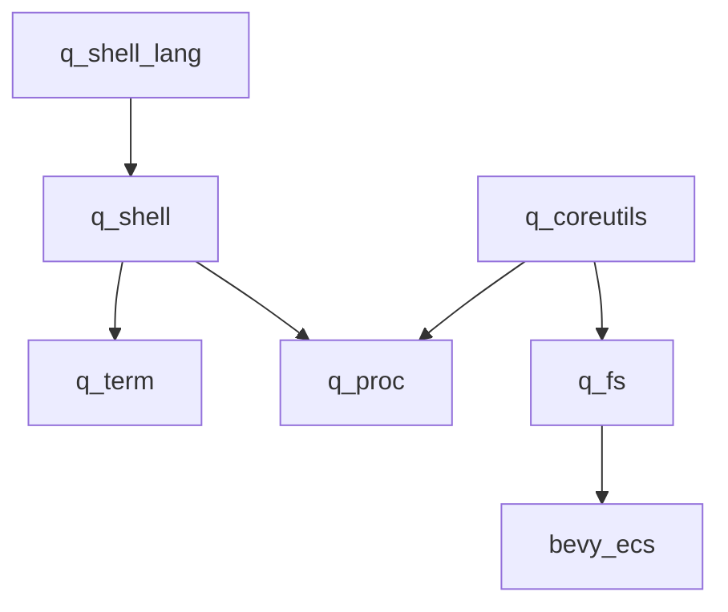

# q_fs

## What

An XPath-derived query language over the World: paths select entities and
components, predicates filter them, and every shorthand desugars to a verbose
form. This is the "Newtonian mechanics" layer of the q_os design doc — a
familiar projection of the ECS suited to naming, navigation, and debugging,
while the ECS remains the layer for relational queries and systems.

A filesystem layer (named-entity tree, POSIX file lifetime, mounts, IO
endpoints) is **deferred** — see the end of this doc. For v0 the fs falls
out of the query syntax: anything a path can address, a filesystem could
serve later.

## Why

- Scripts and coreutils need a familiar object to operate on. Paths are that
  object.
- A live debug interface: `q` reads and writes live game state from a
  terminal.
- The application is a container; Bevy is the runtime. Paths are the
  container's namespace.

## The query language

### Ontology commitment

**Entities are nodes. Components are data. Relationships are components that
can also be traversed as axes.** Fetch and traversal are distinct operations:

| q_fs operation        | Syntax             | Meaning                                      |
| --------------------- | ------------------ | -------------------------------------------- |
| select entity         | `#Name`, `*`       | entity node                                  |
| fetch component       | `T`, `?T`, `^T`    | `QueryData` on the current entity            |
| fetch entity id       | `@`                | `Entity` `QueryData`                         |
| traverse relationship | `R::#Name`, `R::*` | follow `Relationship` / `RelationshipTarget` |
| project value         | `.field`, `[n]`    | reflected field access                       |

`/` separates world steps; `.` projects reflected values. The default
relationship for a node test after an entity is `Children`, so `#Foo/#Bar` ≡
`#Foo/Children::#Bar` and `#Foo/*` ≡ `#Foo/Children::*`. `..` ≡
`ChildOf::*`. Fetching `Children` without `::` returns the component itself;
it does not traverse it.

The world is the root: `/*` selects root entities and `//` is a deep scan.
An omitted prefix is the scan, matching bevy's default query:
`Foo[+Bar]` ≡ `//Foo[+Bar]`. A path begins with a data or node step, so a bare
predicate is invalid: `@[+Brush]`, never `[+Brush]`. Bare `#Floor` searches
the whole world. Names with spaces use BSN's quoted-label form:
`#"Floor West"`.

### Grammar

The sole normative syntax is [`grammar.ebnf`](grammar.ebnf). Semantics and the
validation corpus are in [`q_fs grammar.md`](q_fs%20grammar.md). The grammar is
loaded directly by `tmp/grammar-validation/validate.py` using
`declaresub/abnf`.

### Sigils and sugar

Every shorthand desugars; there is no sugar-only syntax.

| Sugar                   | Desugars to        | Meaning          |
| ----------------------- | ------------------ | ---------------- |
| `(ε)`                   | `//` prefix        | world scan       |
| `@`                     | `Entity`           | entity id data   |
| `?T`                    | `optional(T)`      | `Option<&T>`     |
| `^T`                    | `mut(T)`           | `&mut T`         |
| `?^T`                   | `optional(mut(T))` | `Option<&mut T>` |
| `+T`                    | `with(T)`          | `With<T>`        |
| `-T`                    | `without(T)`       | `Without<T>`     |
| `#Name` after an entity | `Children::#Name`  | named child      |
| `*` after an entity     | `Children::*`      | all children     |
| `..`                    | `ChildOf::*`       | parent entity    |

`@` is **only** the `Entity` fetch: sugar for the reserved builtin `Entity`.
`@T`, `?@`, and `^@` are invalid; `?Entity` and `^Entity` are semantic errors.
Bare `T` is the required component fetch; this keeps
`Query<&Foo, With<Bar>>` close to `Foo[+Bar]`.

### Positions: fetches are QueryData, predicates are QueryFilter

**Fetch position** denotes `QueryData`:

| `QueryData`      | Syntax                     |
| ---------------- | -------------------------- |
| `&T`             | `T`                        |
| `&mut T`         | `^T` / `mut(T)`            |
| `Option<&T>`     | `?T` / `optional(T)`       |
| `Option<&mut T>` | `?^T` / `optional(mut(T))` |
| `Entity`         | `@`                        |
| `Has<T>`         | `boolean(T)`               |
| `Ref<T>`         | `ref(T)`                   |

Resources are out of scope. Tuples and `AnyOf` have no v0 syntax (`|` is
sequence union, not `AnyOf`). `Added<T>` and `Changed<T>` are filter-only.

**Predicate position** denotes `QueryFilter`, plus positional selection.
Predicates attach to the preceding step: `Foo[+Bar]` is
`Query<&Foo, With<Bar>>`. A bare predicate and filter-first spelling are
invalid. Value comparisons are deferred.

### Filter mapping

| Bevy                      | Syntax                               |
| ------------------------- | ------------------------------------ | --------------------- |
| `With<T>`                 | `[with(T)]`, sugar `[+T]`            |
| `Without<T>`              | `[without(T)]`, sugar `[-T]`         |
| `Or<(With<A>, With<B>)>`  | `[+A or +B]`                         |
| tuple AND                 | `[+A][-B]`, `[+A and -B]`, `[+A -B]` |
| `&T`                      | `T`                                  |
| `&mut T`                  | `^T` / `mut(T)`                      |
| `Option<&T>`              | `?T`                                 |
| `Option<&mut T>`          | `?^T`                                |
| `Single<&T>`              | `single(T)`                          |
| `Has<T>`                  | `boolean(T)`                         |
| sequence union            | `A                                   | B`— dedup; not`AnyOf` |
| `Entity`                  | `@`                                  |
| `Added<T>`                | `[added(T)]`                         |
| `Changed<T>`              | `[changed(T)]`                       |
| `Spawned`                 | `[spawned()]`                        |
| relationship target       | `R::*`                               |
| named relationship target | `R::#Name`                           |

### Set semantics

- **The cursor/set rule**: traversing a to-one relationship yields a cursor;
  traversing a to-many yields a set. The moment a path segment fans out, you
  have crossed from path-abstraction into query-abstraction — the
  Newtonian/quantum boundary reproduced inside the path language itself.

- Predicates apply to the **step's result set** — `(foo)[1]` semantics, not
  XPath's sibling-positional `foo[1]`. Deliberate deviation; XPath's actual
  `[1]` is a famous footgun.
- Predicates are 1-based (XPath).
- Space juxtaposition inside brackets is AND, like bevy filter tuples:
  `@[+Enemy -Dead]` ≡ `@[+Enemy][-Dead]`. `or` is always explicit.

### Result model: data on an entity

A query returns the last step's yield; nothing is projected implicitly.
Relationship traversal yields entity ids, component fetches yield component
data, and fields yield reflected values:

| shape     | syntax             | example                                    |
| --------- | ------------------ | ------------------------------------------ |
| entity id | `@` or a node step | `#enemy/@`, `#enemy`, `#Floor/Children::*` |
| component | bare type          | `#enemy/Health`                            |
| field     | `.foo`             | `#enemy/Health.hp`                         |

Every step flat-maps over the current sequence. `/T.foo` is
`Query<&T>::iter().map(|value| value.foo)`. A required fetch (`T`) drops an
entity lacking `T`; `?T` retains it as `None`. Collection-valued fields fan
out, so `Brush.faces[1].material` selects the first face per brush.

Results live in two domains. **Entity domain**: nodes `/` can navigate
from. **Value domain**: component data, which `.` projects into. Every
step's legality follows from which domain the current result is in — and
Entity-typed values belong to both: an id is data _and_ a node.
**Re-entry: access an Entity value, use that value as a node.** The `/`
step after an Entity-valued result is the crossing.

Registered relationships use axes (`Children::*`, `R::*`), which invoke
Bevy's relationship traits rather than assuming field layout. Ordinary stored
Entity references use re-entry:

```
#Terminal/shell.0/Process   — Process on each terminal's stored shell entity
```

`.0` is reflect's newtype field name; a named field reads better. A `/` after
a non-Entity value is a type error. Re-entry composes with flat-map, so chains
like `a.0/b.0/c` hop repeatedly.

Collections are the default; a singleton is the degenerate case
(`single()` asserts it). Two orderings, only one of them semantic:
`Children` order is **data** — the persisted `Vec<Entity>`, editor-
controlled, reliable across runs. Scan order is archetype order — an
implementation detail of spawn and fragmentation history, **not stable
across evaluations or runs**. A sequence is fixed within one evaluation
(it is a `Vec`), but positional predicates over scans (`//*[+Brush][1]`)
are sampling/debug tools, not something a script may rely on. `q` prints
one value per line; pipes carry the whole sequence as one message.

The wire form is a handle plus a projection, not a borrow:

```rust
struct ComponentRef { entity: Entity, component: ComponentId }
enum Projection {
    Id(Entity),                     // @
    Component(ComponentRef),        // T ^T ?T — ?T may read as None
    Field(ComponentRef, FieldPath),  // T.foo — reflect path
}
```

`Ptr`/`MutUntyped` cannot outlive the query scope; handles are `Copy` and
re-resolvable via `World::get_by_id` — the same shape as q_proc's
`IoHandle { entity, component }`. Terminals materialize values by
reflecting through the field path; `^` fetches stay write-through (the
mutation lands inside the query scope, never after it returns).
`QueryResult` stays typed through pipes (a thin `IoMessage` wrapper in the
`q` program) and serializes only at a terminal.

### Extensions

`changed(T)` / `added(T)` / `spawned()` are the one honest extension:
stateful, defined by the querying program's schedule registration (a
per-program tick window, tying into q_proc scheduling). They map to
`Changed<T>` / `Added<T>` / `Spawned` — all `QueryFilter`s — but those have
**no dynamic form**: `with`/`without` got `_id` variants on `QueryBuilder`;
the tick filters did not, and `filter::<Changed<T>>()` needs the compile-time
type. So they are evaluated per-entity against the program's window:
`get_change_ticks_by_id` for components (documented "for implementing change
detection in custom runtimes"), `entity_get_spawn_or_despawn_tick` for
spawns. Semantics mirror the filters exactly: the window is the program's
last run (`Changed` is "since this system last ran", not global ticks);
the predicate records a **read** claim, as `Changed<T>`'s
`update_component_access` does; and it is non-archetypal — per-entity tick
checks, O(a + n). Component-argument only — Bevy change detection is
per-component, so `changed(Brush.faces[1].material)` would be a lie. And
the same caveat as bevy: changes through interior mutability are invisible
unless `set_changed()` is called.

### Dynamic substrate (bevy_ecs 0.19.1)

`QueryBuilder` is the dynamic surface: every filter and fetch has a
runtime-`ComponentId` form, and the sigils map onto builder methods
one-to-one. Terminology trap: "dynamic" in bevy query code means _sparse-set
storage_, so grepping for it finds storage tests, not these methods.

| Term         | Builder method                                                      |
| ------------ | ------------------------------------------------------------------- |
| `+T`         | `with_id(id)`                                                       |
| `-T`         | `without_id(id)`                                                    |
| `T`          | `ref_id(id)` — adds the `With` filter too (required)                |
| `^T`         | `mut_id(id)` — also claims write                                    |
| `?T`         | `optional(\|b\| b.ref_id(id))` — access without the required filter |
| `[+A or +B]` | `or(\|b\| { b.with_id(a); b.with_id(b); })`                         |

The `T` vs `?T` distinction falls out of the builder's own semantics:
`ref_id` = `with_id` + `add_read` (required — absent skips the entity);
`optional` extends access without the required filter (entity kept).

Claims come free: `builder.access() -> &FilteredAccess` is the accumulated
access — the same object type Bevy's scheduler checks. Two programs conflict
iff `a.get_conflicts(b)` is non-empty; `^` needs no custom machinery.

What remains ours:

- the **walker** — node tests and `R::test` traversal over candidate sets. A
  compiled `QueryState` cannot express "targets of this relationship on this
  entity", so axes use Bevy's `Relationship::get` or
  `RelationshipTarget::collection`; stored Entity values use re-entry.
- **predicate evaluation** — `ReflectComponent::reflect` + `PartialReflect::field`
  paths (bevy_reflect 0.19).
- **`changed`/`added`/`spawned`** — `UnsafeEntityCell::get_change_ticks_by_id`
  (unsafe; our recorded claims justify the block) + the program's tick
  window; `entity_get_spawn_or_despawn_tick` for spawns. No dynamic tick
  filter exists in the builder — `with`/`without` got `_id` variants, the
  tick filters did not.
- the **name cache** — name → `ComponentId` populated at registration time by
  typed game code (mirroring `register_io_component`). `Components::get_id`
  maps `TypeId → ComponentId`, but textual names still need resolution; Bevy
  has no `Name` index.

`QueryBuilder::new` needs `&mut World` — exclusive access. q_proc already
runs programs that way (`commands.queue(|world: &mut World| …)` +
`world.run_system_with`), so the fit is exact. Compiled `QueryState`s are
cached per unique path string; building one per invocation would re-scan
archetypes every time.

### Walker sketch (illustrative, not normative)

```rust
use bevy_ecs::{prelude::*, component::ComponentId, query::QueryBuilder,
               world::FilteredEntityRef};

/// One selected node: an entity, or one component of one entity.
#[derive(Clone, Copy)]
struct ComponentRef { entity: Entity, component: ComponentId }

enum Node {
    Entity(Entity),      // entity steps yield ids natively
    Component(ComponentRef),   // T / ^T — present by construction
    Absent(ComponentRef),      // ?T — entity kept, component absent
}

/// Name → ComponentId, populated at registration time by typed game code.
#[derive(Resource, Default)]
struct QueryTypes(HashMap<String, ComponentId>);

/// Rootless queries compile to a QueryState; sigils are builder calls.
fn compile(world: &mut World, types: &QueryTypes, expr: &FilterExpr)
    -> QueryState<FilteredEntityRef>
{
    let mut b = QueryBuilder::<FilteredEntityRef>::new(world);
    for term in expr.terms() {
        match term {
            Term::With(t)        => { b.with_id(types.id(t)); }
            Term::Without(t)     => { b.without_id(types.id(t)); }
            Term::Read(t)        => { b.ref_id(types.id(t)); }
            Term::Write(t)       => { b.mut_id(types.id(t)); }
            Term::OptionalRead(t) => { b.optional(|b| b.ref_id(types.id(t))); }
        }
    }
    b.build()
}

/// Rooted queries walk: each step maps a candidate set to the next.
/// `window` is the program's tick window (for changed/added/spawned).
fn eval(world: &World, types: &QueryTypes, window: &TickWindow, path: &Path)
    -> Vec<Node>
{
    let mut nodes: Vec<Node> = match path.root {
        Some(root) => vec![Node::Entity(root)],
        None => world.iter_entities().map(|e| Node::Entity(e.id())).collect(),
    };
    for step in path.steps() {
        let mut next = Vec::new();
        for entity in nodes.iter().filter_map(|n| n.entity()) {
            match step.test() {
                // #Name — name test (no Name index; O(candidates) is fine)
                Test::Name(name) => {
                    if world.get::<Name>(entity).is_some_and(|n| n.as_str() == name) {
                        next.push(Node::Entity(entity));
                    }
                }
                // Default child axis; explicit R::test uses the same shape
                // through registered Relationship/RelationshipTarget adapters.
                Test::Children(target) => {
                    if let Some(children) = world.get::<Children>(entity) {
                        next.extend(children.iter().copied()
                            .filter(|child| target.matches(world, *child))
                            .map(Node::Entity));
                    }
                }
                Test::Relationship(rel, target) => {
                    next.extend(relationships.follow(world, entity, rel)
                        .filter(|related| target.matches(world, *related))
                        .map(Node::Entity));
                }
                // @ — the id as data (Entity QueryData, a builtin)
                Test::Id => next.push(Node::Entity(entity)),
                // .. — ChildOf, to-one
                Test::Parent => {
                    if let Some(child_of) = world.get::<ChildOf>(entity) {
                        next.push(Node::Entity(child_of.parent()));
                    }
                }
                // T — required fetch: absent component skips the entity
                Test::Read(t) => {
                    let id = types.id(t);
                    if world.get_by_id(entity, id).is_some() {
                        next.push(Node::Component(
                            ComponentRef { entity, component: id }));
                    }
                }
                // ?T — optional fetch: entity kept either way
                Test::OptionalRead(t) => {
                    let id = types.id(t);
                    let r = ComponentRef { entity, component: id };
                    next.push(if world.get_by_id(entity, id).is_some() {
                        Node::Component(r)
                    } else {
                        Node::Absent(r)
                    });
                }
                // ^T — same node as Read; the &mut claim lives in the
                // compiled access set (mut_id → add_write), not in the node.
                // Writes are write-through, in query scope.
                Test::Write(_) => { /* same node as Read; claim at compile */ }
            }
        }
        // predicates filter the step's result set; positions are 1-based
        // (index within `next`, not a sibling position)
        for pred in step.preds() {
            next = next.into_iter().enumerate()
                .filter(|(i, n)| eval_pred(world, types, n, pred, window, i + 1))
                .map(|(_, n)| n).collect();
        }
        nodes = next;
    }
    nodes
}

// v0 predicates: presence (+T / -T), tick windows (changed / added /
// spawned()), and positional selection. Value comparisons
// ([Health.hp < 10]) are deferred — comparison semantics over arbitrary
// reflected types (strings, enums, Vecs, Entity ids) is its own design
// surface.
fn eval_pred(world: &World, types: &QueryTypes, node: &Node, pred: &Pred,
             window: &TickWindow, position: usize) -> bool {
    let Some(entity) = node.entity() else { return false };
    match pred {
        Pred::Present(t)  => world.get_by_id(entity, types.id(t)).is_some(),
        Pred::Absent(t)   => world.get_by_id(entity, types.id(t)).is_none(),
        Pred::Changed(t)  => changed(world, entity, types.id(t), window),
        Pred::Added(t)    => added(world, entity, types.id(t), window),
        Pred::Spawned     => spawned(world, entity, window),
        Pred::Position(i) => position == *i,             // 1-based
    }
}

/// `[changed(T)]` — `Changed<T>` semantics, hand-rolled because the builder
/// has no dynamic tick filter (`with`/`without` got `_id` variants; the tick
/// filters did not). The window is the program's last run; the predicate
/// records a read claim, mirroring `Changed<T>`'s `update_component_access`.
fn changed(world: &World, entity: Entity, id: ComponentId, window: TickWindow) -> bool {
    let ticks = unsafe {
        // SAFETY: read-only tick access; the query claimed this component.
        world.as_unsafe_world_cell()
            .get_entity(entity).ok()
            .and_then(|c| c.get_change_ticks_by_id(id))
    };
    ticks.is_some_and(|t| t.is_changed(window.last_run, window.this_run))
}
```

The two engines compose: a rootless prefix compiles to a `QueryState` scan,
and any rooted suffix walks from those candidates. `q` renders one node per
line; `QueryResult` (the `Vec<Node>` plus its claims) flows through pipes as
a single `IoMessage`.

### Examples

Basics, against `bin/quell/assets/scenes/greybox_scene.bsn` (Floor has three
brush children: Floor West, Speed Lane, Floor Main):

```
#Floor/Children::*/Brush
  → three Brush components (Floor West, Speed Lane, Floor Main)

#Floor/Children::*/Brush.faces[1].material
  → ["materials/greybox_dark_grid.bsn",   # Floor West
     "materials/greybox_blue_grid.bsn",    # Speed Lane
     "materials/greybox_dark_grid.bsn"]   # Floor Main

#Floor/#"Floor West"/Brush       → singleton by default Children traversal
#Floor/Children::*[1]/Brush      → singleton (Floor West)
#Floor/Children                  → the Floor entity's Children component
```

Round-tripped Bevy queries — `Query<D, F>` becomes `D[F]`, and the scan is
the omitted prefix. And `+Enemy`, not `#enemy`: a marker is a component,
`#enemy` is a _name_ test — not interchangeable.

```
Query<&Name, (With<Enemy>, Without<Dead>)>
  → Name[+Enemy -Dead]
Query<&mut Transform, Changed<Velocity>>
  → ^Transform[changed(Velocity)]
Query<&Shell, Or<(With<TerminalA>, With<TerminalB>)>>
  → Shell[+TerminalA or +TerminalB]
Query<&Health, Added<Enemy>>
  → Health[added(Enemy)]
Query<&Transform, Spawned>
  → Transform[spawned()]
Query<Entity, With<Brush>>
  → @[+Brush]
```

Data-first is the only spelling — a path begins with a step, so
filter-first `[+Enemy]/Name` is a syntax error.

Edge cases and difficult queries:

- **Required vs optional fetch**: `#enemy/Health` skips entities lacking
  Health; `#enemy/?Health` keeps every candidate, reading `None` where
  absent. Cost mirrors bevy: `Option<&T>` _broadens_ the query (matches
  more archetypes) — the permissive-looking form can iterate more.
- **Filter vs data presence**: `[+Player]` narrows matches with no access
  (`With`); `boolean(Player)` yields presence as data with no access
  (`Has`). Same zero access, opposite direction.
- **Union vs `AnyOf`**: `Health|Armor` is _sequence union_ — an entity
  carrying both yields both nodes. `AnyOf<(&Health, &Armor)>`'s per-entity
  `(Option, Option)` item needs tuple syntax (open question). The filter
  side, `[+Health or +Armor]`, is exact.
- **Tick windows**: `[changed(Velocity)]` is relative to the querying
  program's _last run_ — a second `q` invocation in the same tick sees
  nothing new. Non-archetypal: per-entity tick checks, O(a + n), unlike
  `[+T]`'s O(a).
- **Re-entry chains**: `#Terminal/shell.0/Process` follows a stored
  `Shell(Entity)`; chains hop (`a.0/b.0/c`); fan-out distributes through
  the crossing.
- **Positional, two meanings**: `#Floor/Children::*[1]` — first in relationship
  order (semantic data; reliable across runs). `@[+Brush][1]` — first in
  scan order (implementation detail; not stable across runs). Both legal;
  the first is a scripting-safe selection, the second is sampling/debug.
- **Multi-fetch is a type error**: `#enemy/Health/Name` — after `Health` you
  hold a component; `/` needs an entity. Two components from one entity need
  tuple syntax (open question) or two queries. (`#enemy/@/Health` is fine —
  `@` re-enters the same entity.)
- **Names are not unique**: `#Floor` matches _every_ entity named Floor;
  collections are the default. `single(#Floor)` asserts the degenerate
  case. Spaces quote: `#"Floor West"`.
- **Empty is not an error**: a path matching nothing yields an empty
  sequence. `single()` is what turns emptiness (or plurality) into one.
- **Write claims**: `#Floor/Children::*/^Brush` claims `&mut Brush` per
  matching child. A second program `^`-fetching Brush conflicts — and so
  does its `[changed(Brush)]`, which records a read claim, exactly as
  `Changed<T>` does in bevy.
- **Interior mutability lies**: `[changed(T)]` sees only changes through
  `Mut`/`&mut` (or `set_changed()`) — a `Mutex` inside `T` mutates
  invisibly. Same caveat as bevy's own change detection.

CLI form desugars to appended steps and predicates:

```
q +Enemy -Dead              ≡  @[+Enemy][without(Dead)]
q #Floor/Children::* ^Brush  ≡  #Floor/Children::*/^Brush
```

Bare filter args are CLI-level sugar — the desugar supplies the explicit
`@` step the language requires.

## Dependency structure



The query language depends only on `bevy_ecs` (+ `bevy_reflect` for field
access) — not on q_proc, and not on the deferred fs. The `q` program lives
with the other programs, wraps `QueryResult` in an `IoMessage` so results
flow through the existing lanes, and renders text at terminals.

## Prior art

- **ornis** — BRP client with a token query nano-language (`Foo`/`@Foo`/`#Foo`/
  `+Foo`/`-Foo` sigils, conjunction by juxtaposition). Validated the sigils
  and the architecture: BRP is a stateless, out-of-process, typed interface to
  the World — the same role q_fs plays in-process.
- **bevy_mod_scripting** — builder chains
  (`world.query():component(A):with(B):build()`). The Rhai `.call()` noise is
  the lesson: host-language method-call query surfaces fight the host's
  syntax; a string grammar parsed once does not.
- **bevy_scriptum** — no query language; queries stay in Rust as system
  params. Validates the "queries in Rust, textual layer orchestrates" split:
  the query language is a second surface, not a prerequisite.
- **XPath** — axes (`child::` default, `parent::foo`), `@` as sugar,
  existential comparison, 1-based predicates. The muscle memory being
  imported.
- **Plan 9** — per-process namespaces, everything-is-a-file-server. The
  container framing.
- **POSIX** — unlink semantics: name/inode separation, refcount lifetime,
  advisory locks orthogonal to unlink.

## Rejected alternatives

- **Bare relationship traversal** (`#Foo/Children/#Bar`). It cannot
  distinguish fetching the `Children` component from following it. Replaced
  by `Children::#Bar`; bare `Children` remains `Query<&Children>`.
- **A dedicated relationship sigil.** Rejected in favor of XPath's existing
  axis separator: `R::test` says to dereference relationship component `R`,
  while stored Entity fields continue to use re-entry.
- **`.` as the id fetch** (`#enemy/.`). `.` pulled double duty — id test in
  step position, field separator after a fetch. Replaced by `@` ≡
  `Entity`; `.` is only ever the field separator.
- **Handles-only results.** Returning component handles and leaving field
  projection to the consumer (`q` reflects, qscript projects). Replaced
  by: results are data on an entity — the id, a whole component, or a
  field — and every step is a flat-map over the sequence.

## Deferred: the filesystem layer

A filesystem is unnecessary for v0 — the query language addresses anything
a path can reach. The design is preserved so nothing is lost:

- **Projection, not approximation.** A fs selects a tree-shaped subset of a
  graph-shaped world and names it. The information loss is access pattern
  (point lookup vs relational query), not precision. The query language is
  the sanctioned escape hatch into the ECS layer.
- **Unix isomorphism.** Directory entry = `Name` + `ChildOf`; inode = the
  `Entity`; open fd = an endpoint component; refcount = observer-maintained
  count of open handles.
- **Strict tree, no hard links** (one `ChildOf`); symlinks are a resolver
  component, not a structural edge.
- **POSIX unlink semantics.** `rm` detaches the name; the entity survives
  until the last descriptor closes. Locks advisory and orthogonal; nothing
  blocks (`EBUSY` fail-fast); `rm -r` detaches before despawning.
- **Mounts.** A `MountTable` resource: prefix → root entity. sysfs
  (synthetic, served from ECS state), hostfs (async over `AssetServer`),
  world-local.
- **Synthetic files are the killer feature**: `echo 100 > /sys/player/health`
  lands as an observer write into game state. Serve lazily; never mirror
  ECS state into file entities.
- **Endpoints are `IoComponent`s**, so reads/writes compose with pipes and
  redirection unchanged.

## Open questions

- Crate name: `q_fs` described a filesystem. `q_query`? `q_path`?
- `#`-only name tests, or bare name tests too? BSN always writes `#`; XPath
  muscle memory says bare. Leaning `#`-only for BSN parity.
- Text rendering of results at terminals: one line per handle, BSN-ish,
  debug?
- Tuple fetches (`(Name, Health)` — `QueryData` tuples) have no syntax
  yet; needed, or is running two queries / qscript projection enough?
- Does qscript's `with … do` bind query results via streams (stdout) or via a
  first-class selection? Streams compose; selections are tighter.

- Predicate value comparisons — **deferred from v0**. Not just numeric and
  boolean: strings, enums, Vecs, Entity ids all compare differently
  (equality vs ordering, case, sequence semantics). When they arrive,
  comparisons over sequences should be existential (XPath node-set
  semantics), and the `-T` sigil may collide with numeric negation —
  resolve then.
- Entity disabling (`DefaultQueryFilters`): bevy queries exclude disabled
  entities unless a filter opts out (`Allow<T>`); the walker's raw world
  iteration does not exclude them. Align the walker or document the
  divergence; decide `Allow` syntax (`[allow(T)]`?).
