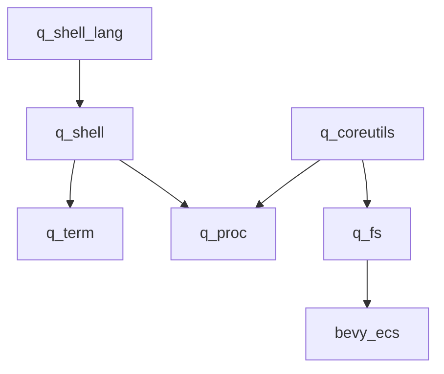

# q_fs

## What

An XPath-derived query language over the World: paths select entities and
components, predicates filter them, and every shorthand desugars to a verbose
form. This is the "Newtonian mechanics" layer of the q_os design doc — a
familiar projection of the ECS suited to naming, navigation, and debugging,
while the ECS remains the layer for relational queries and systems.

The filesystem half of the original design (named-entity tree, POSIX file
lifetime, mounts, IO endpoints) is **deferred** — see the end of this doc.
For v0 the fs falls out of the query syntax: anything a path can address, a
filesystem could serve later.

## Why

- Scripts and coreutils need a familiar object to operate on. Paths are that
  object.
- A live debug interface: `q` reads and writes live game state from a
  terminal.
- The application is a container; Bevy is the runtime. Paths are the
  container's namespace.

## The query language

### Ontology commitment

**Components are attributes. Entities are elements. Relationships are axes.**
This one commitment resolves the syntax:

| XPath           | q_fs             | Syntax                       |
| --------------- | ---------------- | ---------------------------- |
| element         | entity           | `#Name`, `*`                 |
| attribute       | component        | `@T`                         |
| axis            | relationship     | `child::`, `parent::`, `R::` |
| attribute value | component fields | `.` steps                    |

`/` is a **world step** (entity→entity via relationship, entity→component).
`.` is a **reflect-value step** (component→field→field). Each domain borrows
its native muscle memory: paths look like paths, field access looks like Rust.

The default downward axis is the `Children` relationship; `*` ≡ `Children::*`.
`..` ≡ `parent::*` ≡ following `ChildOf` (to-one). Names with spaces use BSN's
quoted-label form: `#"Floor West"`.

### Grammar sketch (illustrative, not normative)

```
path   := '/'? step ('/' step)*
step   := axis? test predicate*
test   := '#' name | '*' | '..' | '.' | '@' type | '?' type | '^' type
axis   := relationship '::'
pred   := '[' expr ']'      -- exprs include field paths: @Health.hp < 10
```

### Sigils and sugar

Every shorthand desugars; there is no sugar-only syntax. (XPath itself is
specified this way: `@` ≡ `attribute::`, `//` ≡ `descendant-or-self::`,
`..` ≡ `parent::node()`.)

| Sugar   | Desugars to    | Meaning            |
| ------- | -------------- | ------------------ |
| `#Name` | name test      | entity by name     |
| `@T`    | `attribute::T` | `&T` fetch         |
| `?T`    | `optional(@T)` | `Option<&T>` fetch |
| `*`     | `Children::*`  | all children       |
| `..`    | `parent::*`    | ChildOf (to-one)   |
| `+T`    | `[@T]`         | `With<T>`          |
| `-T`    | `[not(@T)]`    | `Without<T>`       |
| `^T`    | `mut(@T)`      | `&mut T` fetch     |

Sigils split by position. **Filter position** (inside `[...]`): `+T` ≡ `[@T]`
and `-T` ≡ `[not(@T)]`. `+` is not redundant — `@T` in _step_ position is a
fetch; `+T` is the filter-position sigil for the presence test. **Fetch
position** (a step): `@T` reads and skips the entity if absent; `?T` reads
optionally — the entity is kept and the result is `None`; `^T` claims `&mut`.
`^` is an access-mode _claim_ with scheduling consequences: two programs
`^`-fetching the same component conflict exactly like `&mut`/`&mut` in
Bevy's scheduler.

### Filter mapping

| Bevy                         | Syntax                                 |
| ---------------------------- | -------------------------------------- |
| `With<T>`                    | `[@T]`, sugar `[+T]`                   |
| `Without<T>`                 | `[not(@T)]`, sugar `[-T]`              |
| `Or<(With<A>, With<B>)>`     | `[@A or @B]`                           |
| tuple AND                    | `[@A][@B]` or `[@A and @B]`            |
| `&T` fetch                   | `/@T` step — skipped if absent         |
| `&mut T` fetch               | `/^T` or `/mut(@T)`                    |
| `Option<&T>`                 | `/?T` — kept, `None` if absent         |
| `Option<&mut T>`             | `/?^T` or `/optional(mut(@T))`         |
| required `&T`                | `exactly-one(@T)`                      |
| `Has<T>` (as data)           | `boolean(@T)`                          |
| `AnyOf<(&A, &B)>`            | `@A \| @B` (union)                     |
| `Entity` (as data)           | `.` / `id(.)`                          |
| `Added<T>`                   | `[added(@T)]` — extension              |
| `Changed<T>`                 | `[changed(@T)]` — extension            |
| field filter (no Bevy equiv) | `[@Health.hp < 10]`                    |
| positional (no Bevy equiv)   | `[1]`, `[last()]`, `[position() <= 5]` |
| `Children` (target)          | `*` / `Children::*`                    |
| `ChildOf`                    | `..`                                   |
| custom relationship `R`      | `R::*`                                 |

### Set semantics

- **The cursor/set rule**: traversing a to-one relationship yields a cursor;
  traversing a to-many yields a set. The moment a path segment fans out, you
  have crossed from path-abstraction into query-abstraction — the
  Newtonian/quantum boundary reproduced inside the path language itself.
- Comparisons over sets are **existential** (XPath node-set semantics):
  `#Floor/Children[@Brush.faces.material = "…"]` is true if _any_ face
  matches.
- Predicates apply to the **step's result set** — `(foo)[1]` semantics, not
  XPath's sibling-positional `foo[1]`. Deliberate deviation; XPath's actual
  `[1]` is a famous footgun.
- Predicates are 1-based (XPath).

### Result model: paths return nodes, expressions return values

XPath's own split, kept: a path evaluates to a **node-set** (entities and
components); values (strings, numbers) appear only inside predicates and
expressions. Field access (`.field`) therefore lives in predicates for v0 —
`[@Health.hp < 10]` — and trailing projection (`@Brush.faces[1].material`)
is not path syntax. Rendering a component's fields is the consumer's job:
`q` reflects the handle, qscript projects.

**Collections are the default, not the special case.** A result is a
sequence of nodes: `#Floor/Children/@Brush` yields three, a singleton path
yields a size-1 sequence, and `exactly-one()` asserts the degenerate case.
Ordering is deterministic: `Children` steps preserve the
`Children(Vec<Entity>)` order (editor-controlled), and scan results come in
archetype order (stable within a run, semantically arbitrary — positional
predicates over scans are deterministic but meaningless). `q` prints one
node per line; pipes carry the whole sequence as one message.

The node is a **handle**, not a borrow:

```rust
struct ComponentRef { entity: Entity, component: ComponentId }
enum Node { Entity(Entity), Component(ComponentRef), Absent(ComponentRef) }
// Absent: a ?T fetch on an entity lacking T — kept, reads as None
```

`Ptr`/`MutUntyped` borrow the World and cannot outlive the query scope;
handles are `Copy`, storable, and re-resolvable via `World::get_by_id`. Same
shape as q_proc's `IoHandle { entity, component }` — a runtime-typed
reference to one capability of one entity. `^` fetches record an access
claim on the handle; the actual `&mut` access happens inside the query scope
(write-through), never after it returns.

`QueryResult` stays typed through pipes (a thin `IoMessage` wrapper in the
`q` program) and serializes only at a terminal.

### Extensions

`changed(@T)` / `added(@T)` are the one honest extension: stateful, defined by
the querying program's schedule registration (a per-program tick window, tying
into q_proc scheduling). Component-argument only — Bevy change detection is
per-component, so `changed(@Brush.faces[1].material)` would be a lie. The
substrate exists: `get_change_ticks_by_id` reads a component's ticks by
`ComponentId` (documented "for implementing change detection in custom
runtimes"); the extension is just the window-tick comparison.

### Dynamic substrate (bevy_ecs 0.19.1)

`QueryBuilder` is the dynamic surface: every filter and fetch has a
runtime-`ComponentId` form, and the sigils map onto builder methods
one-to-one. (An earlier draft claimed bevy*ecs had no runtime query
construction — wrong; the `_id` methods are it. Beware the terminology trap:
"dynamic" in bevy query code means \_sparse-set storage*, so grepping for it
finds storage tests, not these.)

| Term         | Builder method                                                      |
| ------------ | ------------------------------------------------------------------- |
| `+T`         | `with_id(id)`                                                       |
| `-T`         | `without_id(id)`                                                    |
| `@T`         | `ref_id(id)` — adds the `With` filter too (required)                |
| `^T`         | `mut_id(id)` — also claims write                                    |
| `?T`         | `optional(\|b\| b.ref_id(id))` — access without the required filter |
| `[+A or +B]` | `or(\|b\| { b.with_id(a); b.with_id(b); })`                         |

The `@T` vs `?T` distinction falls out of the builder's own semantics:
`ref_id` = `with_id` + `add_read` (required — absent skips the entity);
`optional` extends access without the required filter (entity kept).

Claims come free: `builder.access() -> &FilteredAccess` is the accumulated
access — the same object type Bevy's scheduler checks. Two programs conflict
iff `a.get_conflicts(b)` is non-empty; `^` needs no custom machinery.

What remains ours:

- the **walker** — navigation (name tests, `Children`/`ChildOf`/`R::` axes)
  over candidate sets. A compiled `QueryState` iterates the whole world and
  cannot express "children of _this_ entity", so steps walk via
  `get::<Children>` / `get_by_id` instead.
- **predicate evaluation** — `ReflectComponent::reflect` + `PartialReflect::field`
  paths (bevy_reflect 0.19).
- **`changed`/`added`** — `UnsafeEntityCell::get_change_ticks_by_id` (unsafe;
  our recorded claims justify the block) + the program's tick window. No
  dynamic `changed` filter exists in the builder.
- the **name cache** — name → `ComponentId` populated at registration time by
  typed game code (mirroring `register_io_component`); no `TypeId →
ComponentId` lookup exists in 0.19, and Bevy has no `Name` index.

`QueryBuilder::new` needs `&mut World` — exclusive access. q_proc already
runs programs that way (`commands.queue(|world: &mut World| …)` +
`world.run_system_with`), so the fit is exact. Compiled `QueryState`s are
cached per unique path string; building one per invocation would re-scan
archetypes every time.

### Walker sketch (illustrative, not normative)

```rust
use bevy_ecs::{prelude::*, component::ComponentId, query::QueryBuilder,
               world::FilteredEntityRef};

/// One selected node: an entity, or one component of one entity.
#[derive(Clone, Copy)]
struct ComponentRef { entity: Entity, component: ComponentId }

enum Node {
    Entity(Entity),
    Component(ComponentRef),   // @T / ^T — present by construction
    Absent(ComponentRef),      // ?T — entity kept, component absent
}

/// Name → ComponentId, populated at registration time by typed game code.
#[derive(Resource, Default)]
struct QueryTypes(HashMap<String, ComponentId>);

/// Rootless queries compile to a QueryState; sigils are builder calls.
fn compile(world: &mut World, types: &QueryTypes, expr: &FilterExpr)
    -> QueryState<FilteredEntityRef>
{
    let mut b = QueryBuilder::<FilteredEntityRef>::new(world);
    for term in expr.terms() {
        match term {
            Term::With(t)        => { b.with_id(types.id(t)); }
            Term::Without(t)     => { b.without_id(types.id(t)); }
            Term::Read(t)        => { b.ref_id(types.id(t)); }
            Term::Write(t)       => { b.mut_id(types.id(t)); }
            Term::OptionalRead(t) => { b.optional(|b| b.ref_id(types.id(t))); }
        }
    }
    b.build()
}

/// Rooted queries walk: each step maps a candidate set to the next.
fn eval(world: &World, types: &QueryTypes, path: &Path) -> Vec<Node> {
    let mut nodes: Vec<Node> = match path.root {
        Some(root) => vec![Node::Entity(root)],
        None => world.iter_entities().map(|e| Node::Entity(e.id())).collect(),
    };
    for step in path.steps() {
        let mut next = Vec::new();
        for entity in nodes.iter().filter_map(|n| n.entity()) {
            match step.test() {
                // #Name — name test (no Name index; O(candidates) is fine)
                Test::Name(name) => {
                    if world.get::<Name>(entity).is_some_and(|n| n.as_str() == name) {
                        next.push(Node::Entity(entity));
                    }
                }
                // default axis: Children, in Vec order (deterministic)
                Test::Children => {
                    if let Some(children) = world.get::<Children>(entity) {
                        next.extend(children.iter().map(|c| Node::Entity(*c)));
                    }
                }
                // .. — ChildOf, to-one
                Test::Parent => {
                    if let Some(child_of) = world.get::<ChildOf>(entity) {
                        next.push(Node::Entity(child_of.parent()));
                    }
                }
                // @T — required fetch: absent component skips the entity
                Test::Read(t) => {
                    let id = types.id(t);
                    if world.get_by_id(entity, id).is_some() {
                        next.push(Node::Component(
                            ComponentRef { entity, component: id }));
                    }
                }
                // ?T — optional fetch: entity kept either way
                Test::OptionalRead(t) => {
                    let id = types.id(t);
                    let r = ComponentRef { entity, component: id };
                    next.push(if world.get_by_id(entity, id).is_some() {
                        Node::Component(r)
                    } else {
                        Node::Absent(r)
                    });
                }
                Test::Write(t) => { /* as Read; the claim was recorded at compile */ }
            }
        }
        // predicates filter the step's result set; positions are 1-based
        for pred in step.preds() {
            next.retain(|n| eval_pred(world, types, n, pred));
        }
        nodes = next;
    }
    nodes
}

/// `[@Health.hp < 10]` — reflect the component, walk fields, compare.
fn eval_pred(world: &World, types: &QueryTypes, node: &Node, pred: &Pred) -> bool {
    let (entity, id) = pred.lhs();               // (@Health, field path .hp)
    let type_id = world.components().get_info(id)
        .and_then(|i| i.type_id()).unwrap();
    let data = registry.get(type_id).unwrap()
        .data::<ReflectComponent>().unwrap();
    let value = data.reflect(world.entity(entity)).unwrap();  // &dyn Reflect
    let value = pred.field_path()
        .fold(value, |v, f| v.field(f).unwrap());
    pred.compare(value)                         // reflect → f64 / &str
}

/// `[changed(@T)]` — the one hand-rolled extension.
fn changed(world: &World, entity: Entity, id: ComponentId, window: TickWindow) -> bool {
    let ticks = unsafe {
        // SAFETY: read-only tick access; the query claimed this component.
        world.as_unsafe_world_cell()
            .get_entity(entity).ok()
            .and_then(|c| c.get_change_ticks_by_id(id))
    };
    ticks.is_some_and(|t| t.is_changed(window.last_run, window.this_run))
}
```

The two engines compose: a rootless prefix compiles to a `QueryState` scan,
and any rooted suffix walks from those candidates. `q` renders one node per
line; `QueryResult` (the `Vec<Node>` plus its claims) flows through pipes as
a single `IoMessage`.

### Examples

Against `bin/quell/assets/scenes/greybox_scene.bsn` (Floor has three brush
children: Floor West, Speed Lane, Floor Main):

```
#Floor/Children/@Brush
  → three ComponentRef handles (Floor West, Speed Lane, Floor Main)

#Floor/Children/@Brush[.faces[1].material = "materials/greybox_dark_grid.bsn"]
  → Floor West and Floor Main (Speed Lane is blue)

#Floor/#"Floor West"/@Brush      → singleton by name
#Floor/Children[1]/@Brush        → singleton (Floor West)
```

Field paths appear in predicates; `q` reflects handles for display.

Round-tripped Bevy queries:

```
Query<&Name, (With<Enemy>, Without<Dead>)>
  → #enemy[-Dead]/@Name
Query<&mut Transform, Changed<Velocity>>
  → //*[changed(@Velocity)]/^Transform
Query<&Shell, Or<(With<TerminalA>, With<TerminalB>)>>
  → /*[+TerminalA or +TerminalB]/@Shell
```

CLI form desugars to appended predicates:

```
q #enemy +Health -Dead        ≡  #enemy[@Health][not(@Dead)]
q #Floor/Children ^Brush      ≡  write-fetch of @Brush on each child
```

## Dependency structure



The query language depends only on `bevy_ecs` (+ `bevy_reflect` for field
access) — not on q_proc, and not on the deferred fs. The `q` program lives
with the other programs, wraps `QueryResult` in an `IoMessage` so results
flow through the existing lanes, and renders text at terminals.

## Prior art

- **ornis** — BRP client with a token query nano-language (`Foo`/`@Foo`/`#Foo`/
  `+Foo`/`-Foo` sigils, conjunction by juxtaposition). Validated the sigils
  and the architecture: BRP is a stateless, out-of-process, typed interface to
  the World — the same role q_fs plays in-process.
- **bevy_mod_scripting** — builder chains
  (`world.query():component(A):with(B):build()`). The Rhai `.call()` noise is
  the lesson: host-language method-call query surfaces fight the host's
  syntax; a string grammar parsed once does not.
- **bevy_scriptum** — no query language; queries stay in Rust as system
  params. Validates the "queries in Rust, textual layer orchestrates" split:
  the query language is a second surface, not a prerequisite.
- **XPath** — axes (`child::` default, `parent::foo`), `@` as sugar,
  existential comparison, 1-based predicates. The muscle memory being
  imported.
- **Plan 9** — per-process namespaces, everything-is-a-file-server. The
  container framing.
- **POSIX** — unlink semantics: name/inode separation, refcount lifetime,
  advisory locks orthogonal to unlink.

## Deferred: the filesystem layer

The original design led with a filesystem; the query language made it
unnecessary for v0. Preserved so nothing is lost:

- **Projection, not approximation.** A fs selects a tree-shaped subset of a
  graph-shaped world and names it. The information loss is access pattern
  (point lookup vs relational query), not precision. The query language is
  the sanctioned escape hatch into the ECS layer.
- **Unix isomorphism.** Directory entry = `Name` + `ChildOf`; inode = the
  `Entity`; open fd = an endpoint component; refcount = observer-maintained
  count of open handles.
- **Strict tree, no hard links** (one `ChildOf`); symlinks are a resolver
  component, not a structural edge.
- **POSIX unlink semantics.** `rm` detaches the name; the entity survives
  until the last descriptor closes. Locks advisory and orthogonal; nothing
  blocks (`EBUSY` fail-fast); `rm -r` detaches before despawning.
- **Mounts.** A `MountTable` resource: prefix → root entity. sysfs
  (synthetic, served from ECS state), hostfs (async over `AssetServer`),
  world-local.
- **Synthetic files are the killer feature**: `echo 100 > /sys/player/health`
  lands as an observer write into game state. Serve lazily; never mirror
  ECS state into file entities.
- **Endpoints are `IoComponent`s**, so reads/writes compose with pipes and
  redirection unchanged.

## Open questions

- Crate name: `q_fs` described a filesystem. `q_query`? `q_path`?
- `#`-only name tests, or bare name tests too? BSN always writes `#`; XPath
  muscle memory says bare. Leaning `#`-only for BSN parity.
- Text rendering of results at terminals: one line per handle, BSN-ish,
  debug?
- Trailing field projection (`@Brush.faces[1].material`) was cut from path
  syntax — restore later as sugar (fetch handle, reflect-read) if missed?
- Does qscript's `with … do` bind query results via streams (stdout) or via a
  first-class selection? Streams compose; selections are tighter.
- Relationship-as-filter form: `#Terminal/Children[Shell]` (child that has a
  `Shell` component) falls out of predicate semantics for free — is that
  enough, or do we want a dedicated form?
