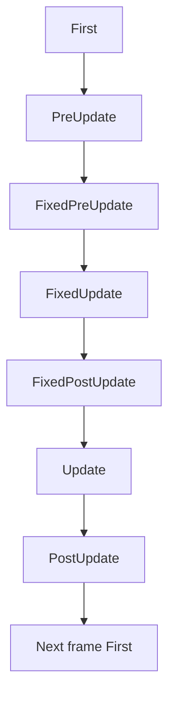
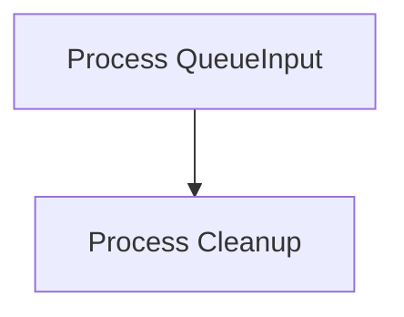
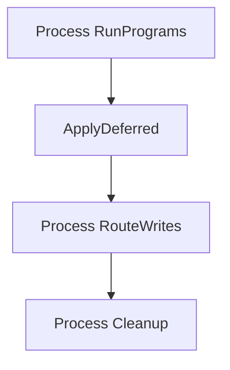
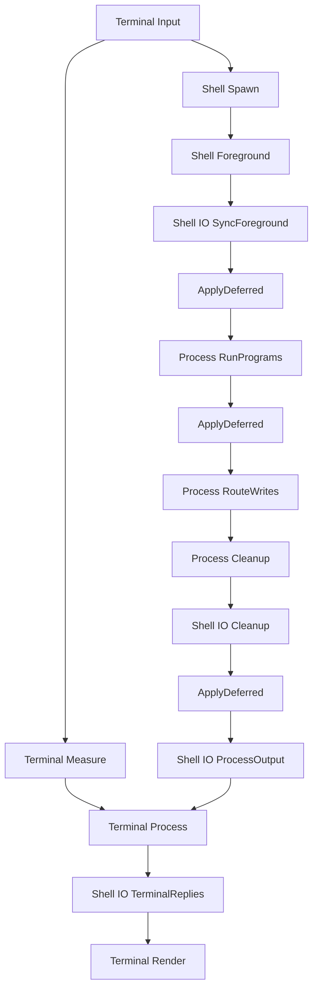
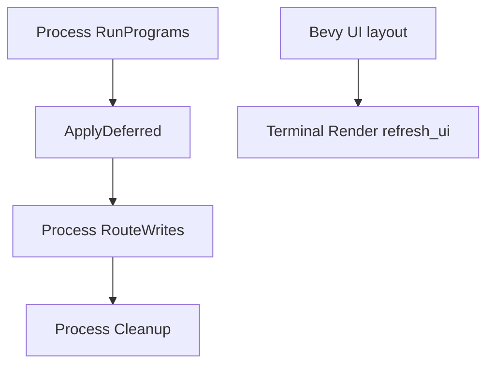

# q_os schedule ordering

This documents the default schedule configuration across `q_proc`, `q_shell`, and `q_term`.

Both `ShellPlugin::new` and `TerminalPlugin::new` can relocate their phases. The diagrams below show their defaults.

## Frame overview

`q_proc` installs its program chain in `PreUpdate`, `FixedPreUpdate`, `FixedUpdate`, `FixedPostUpdate`, `Update`, and `PostUpdate`.

## First

`ProcessInputMsg` values emitted during one frame are retained until `QueueInput` demultiplexes them into process-local buffers during the next `First` schedule.

## Repeated process schedule

This chain runs in every supported program schedule:

The chain is installed in:

- `PreUpdate`
- `FixedPreUpdate`
- `FixedUpdate`
- `FixedPostUpdate`
- `Update`
- `PostUpdate`

## Default Update integration

`Terminal Measure` and the shell/process branch may run concurrently after `Terminal Input`. They converge at `Terminal Process`.

The cleanup barrier makes process removal and foreground fallback visible before q_term applies terminal output admission. VT replies emitted by `Terminal Process` become `ProcessInputMsg` values in the same `Update`, then enter the destination process buffer during the next frame's `First` schedule.

## PostUpdate

Two independent chains run in `PostUpdate`:

The default shell I/O adapter runs in `Update`, not `PostUpdate`. Process output emitted during `PostUpdate` is therefore translated and processed during the following `Update`.
