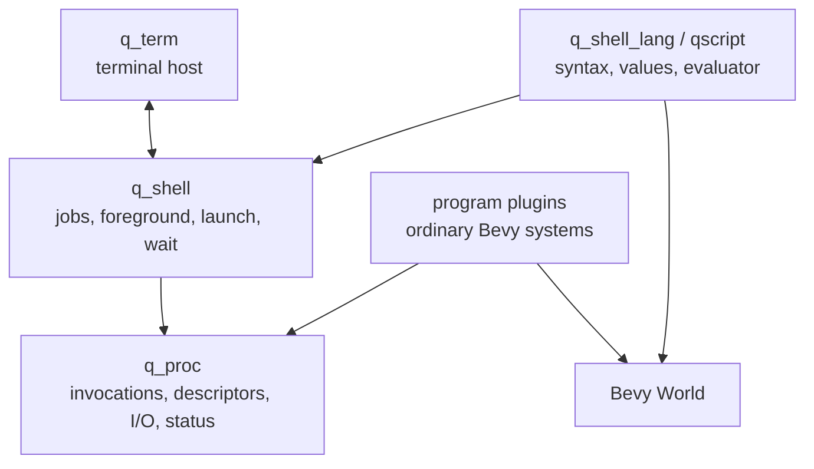
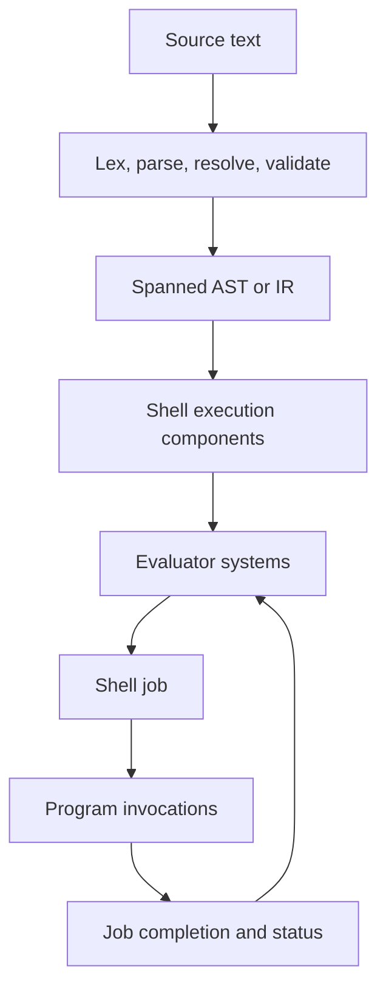
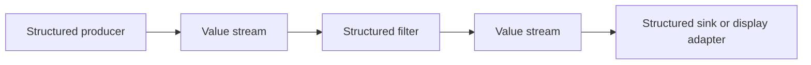
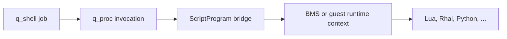

# qscript shell language design direction

Date: 2026-09-22
Status: **design direction; language implementation not started**
Crate: `q_shell_lang`
Language working name: **qscript**

## Purpose

qscript is the native shell and scripting language for q_os. It provides an
imperative textual interface to a Bevy application: users can launch programs,
compose them into pipelines, wait for work spanning multiple frames, inspect and
mutate ECS state, and save the same commands as scripts.

qscript is both:

- a **shell language**, because it resolves programs, constructs jobs and
  pipelines, controls foreground execution, carries environment state, and runs
  interactively through q_term; and
- a **programming language**, because it has values, expressions, variables,
  lexical scope, control flow, reusable definitions, and an evaluator independent
  of the interactive terminal.

This document records the current architectural direction. It is not a complete
syntax specification or implementation plan.

## Related documents

Read these before changing the language or its execution substrate:

1. `.docs/designs/q_os design.md`
2. `.docs/handoffs/done/ordinary-system-job-model-design.md`
3. `.docs/handoffs/done/ordinary-system-job-model-handoff.md`
4. `.docs/plans/done/process-terminal-io-bridge-plan.md`
5. `.docs/plans/done/shell-registered-program-dispatch-design.md`

The ordinary-system job model is the accepted execution direction. Where older
q_shell research or pre-design notes assume per-invocation `SystemId` dispatch,
Bevy system piping, or a `Lang` trait inside q_shell, this document follows the
newer ordinary-system design instead.

The registered-program interpreter is a useful bootstrap shell: it provides
name lookup, tokenization, launch, wait, errors, and prompt redraw. Its `shlex`
grammar is not the final qscript grammar and should not constrain qscript's
parser.

## Goals

qscript should eventually support:

- interactive REPL use through q_term;
- scripts loaded from source files or assets;
- commands that run for one frame or many frames;
- non-blocking imperative sequencing across Bevy frames;
- structured values and structured pipelines;
- byte-oriented programs through explicit adapters;
- command signatures usable by parsing, diagnostics, help, and completion;
- lexical variables, expressions, blocks, closures, and control flow;
- first-class entity identifiers and ECS-oriented commands;
- extensibility by applications without modifying the language crate;
- coexistence with Lua, Rhai, Python, and other scripting runtimes.

## Non-goals

qscript is not intended to be:

- POSIX-compatible;
- a host operating-system shell;
- a security or memory-isolation boundary;
- a VFS design;
- an alternate Bevy scheduler;
- a textual spelling of arbitrary Rust or Bevy system signatures;
- an implementation of Lua, Rhai, or Python on top of qscript;
- built on a general-purpose `eval` facility.

POSIX-like punctuation and shell conventions may be used where they improve
familiarity, but qscript semantics should follow q_os and Bevy rather than
reproduce Unix behavior.

## Existing q_os layers

The language builds on four distinct layers:



### q_proc

q_proc owns language-independent invocation mechanics:

- invocation identity and lifecycle;
- running, waiting, and exited state;
- exit status;
- descriptors and endpoint-neutral I/O routing;
- process input queues;
- pipe and tee endpoints;
- signals and cancellation primitives;
- common execution and completion system sets.

A q_proc invocation is cooperative and shares the application's Bevy World. It
is not an isolated process.

The accepted ordinary-system model installs each program's systems normally in
the app schedule. Program-specific marker and state components distinguish its
active invocations. qscript must not depend on the older design in which q_proc
enumerates processes and calls hidden systems through `World::run_system_with`.

### q_shell

q_shell owns language-independent shell mechanics:

- shell sessions and their controlling terminal or other I/O endpoint;
- runtime program lookup and launch;
- shell jobs and process groups;
- descriptor graph construction for pipelines and redirection;
- foreground and background ownership;
- waiting for job completion;
- terminal/process adaptation.

q_shell must remain usable by interpreters other than qscript. Lua, Python, Rhai,
or an application-specific command language should be able to use these
primitives without implementing qscript's AST or values.

### q_shell_lang

q_shell_lang owns qscript semantics:

- lexing and parsing with source spans;
- AST and/or lowered IR;
- qscript values and types;
- lexical scopes and environment bindings;
- command signatures and argument parsing;
- static validation available before evaluation;
- evaluator continuations stored as ECS state;
- structured-pipeline behavior;
- final-value display policy for interactive use;
- qscript-native ECS query and mutation commands.

### q_term

q_term owns terminal behavior only:

- terminal input and output bytes;
- VT parsing and replies;
- buffer, cursor, viewport, and rendering state;
- host focus and keyboard integration surfaces.

It does not parse qscript or know q_proc job semantics.

## Runtime ontology

The following terms are distinct:

| Term | Meaning |
| --- | --- |
| Program | Reusable behavior installed as ordinary Bevy systems |
| Invocation | One running instance of a program, represented by an entity |
| Job | A shell-owned unit of work, potentially containing a pipeline of invocations |
| Shell execution | One imperative qscript evaluation and its continuation |
| Shell session | Persistent interactive state associated with a shell |

A shell execution is not itself synonymous with a child invocation. It may
launch several jobs over its lifetime and suspend between them.

## Evaluation model

qscript uses a strict parse/evaluate split inspired by Nushell:



The evaluator is an ECS state machine. A shell-execution entity stores the
source/IR reference, lexical environment, continuation or instruction pointer,
current pipeline value, and wait reason. It runs until it:

- produces a result;
- reaches an instruction budget and yields;
- launches work and enters `WaitingFor(job)`;
- waits for another explicit event; or
- fails or exits.

It must never block the Bevy thread while waiting for another frame, process
input, a timer, or job completion.

For a conceptual expression such as `a | b && c`, evaluation constructs one job
for the `a | b` pipeline, waits for that job, and advances to `c` only if the
job's status satisfies the conditional operator.

### No general-purpose eval

The parser should see one complete submitted command line or script before that
unit begins evaluation. qscript does not initially provide an `eval` operation
that parses dynamically constructed source during evaluation.

Separate REPL submissions are separate parse/evaluate cycles. Persistent session
state is merged between submissions. This permits an interactive definition or
environment change to affect later submissions without making a single source
unit dynamically self-modifying.

This decision preserves reliable name resolution, diagnostics, completion, and
future static analysis. It can be reconsidered only for a concrete use case.

## qscript values

qscript has its own owned `Value` model. It is not defined by terminal bytes,
Rust generic types, BMS `ScriptValue`, Rhai `Dynamic`, or Lua values.

The initial conceptual set is:

```text
Nothing
Bool
Int
Float
String
Binary
Entity
List<Value>
Record<ordered String, Value>
```

Likely later values include durations, ranges, cell paths, errors, and closures.
The exact Rust representation and type names remain open.

Important properties:

- values crossing process I/O must be owned and satisfy q_proc's message-lane
  requirements;
- records preserve field order for deterministic display and introspection;
- tables are initially lists of records rather than a separate fundamental
  representation;
- `Entity` values retain Bevy's generational identity rather than only an index;
- language-level errors retain source spans and are not ordinary successful
  pipeline values;
- runtime-local closures or foreign references must not silently become portable
  pipeline values.

A distinction may be required between all evaluator values and the subset that
is safe to transport through a q_proc pipeline. Do not force guest-runtime
functions, borrowed reflected references, or World borrows into the transport
subset.

## Structured pipelines

A qscript pipeline carries qscript values, not their displayed terminal text.
Rendering occurs only at an explicit adapter or at the end of an interactive
pipeline.

Conceptually:



q_proc already supports typed message lanes and pipe endpoints. qscript can use a
qscript-specific pipeline message type over that generic transport. The final
protocol must represent at least:

- a produced value;
- orderly end of stream;
- failure or cancellation;
- job completion and exit status.

Bounded capacity, backpressure, wakeups, and EOF semantics are substrate work
still required before fully streaming pipelines are complete.

### Do not use Bevy system `.pipe()` for shell pipelines

Bevy's `.pipe()` composes synchronous system functions. A qscript pipeline
contains independent invocation entities that may run over many frames and must
participate in descriptors, jobs, cancellation, and foreground control.
Therefore shell pipelines are job and endpoint graphs, not Bevy `.pipe()`
chains.

## Programs and commands

qscript should distinguish structured commands from raw byte-oriented programs.
Both may be represented as q_proc programs and invocations, but they publish
different interfaces.

### Structured qscript commands

Structured commands accept and produce qscript values. They publish explicit
metadata:

- name and documentation;
- positional and named arguments;
- argument value types and completion behavior;
- accepted pipeline input/output type pairs;
- initializer or factory used to compose a new invocation entity;
- optional visibility or authorization predicate supplied by the application.

The same metadata should drive parsing, diagnostics, help, and completion.

Do not infer a user-facing command signature from an arbitrary Bevy system
signature. `Query`, `Res`, `Commands`, and similar system parameters describe an
implementation's World access, not textual command arguments. Reflection is
useful for argument values and ECS metadata but is not a substitute for an
explicit command signature.

### Raw programs

Raw programs use conventional arguments, string environment variables, and byte
I/O. q_coreutils may provide these without depending on q_shell_lang.

Adapters bridge the two domains:

```text
qscript Value stream -> explicit encoder -> byte-oriented program stdin
byte-oriented program stdout -> explicit decoder -> qscript Value stream
```

There should be no implicit conversion of a rendered table into program input.
The script must select an appropriate text, binary, JSON, or other adapter.

## Variables and environments

qscript should distinguish:

- lexical language variables, which may hold any qscript value; and
- process environment variables, which are strings inherited by launched raw
  programs.

A likely surface convention is `$name` for lexical variables and `$env.NAME` for
process environment. Exact syntax remains open, but conflating both into a
single `$VAR -> String` mechanism would prevent lists, records, entities, and
closures from behaving naturally.

Interactive session state persists between separately submitted REPL units.
Block and function scopes remain lexical. Environment mutations require explicit
semantics for whether they remain local or propagate back to the shell session.

## ECS access

ECS interaction is a defining qscript capability, but World borrows must not
escape command execution.

The initial model should expose query and mutation as commands. A query command
resolves component names through Bevy reflection, runs against current World
state, and emits owned values such as records and entity identifiers.

Conceptually:

```qscript
query Entity Health --with Enemy
| where {|row| $row.health.current < $row.health.max }
| component set Health.current 10
```

This syntax is illustrative, not accepted grammar.

### Query values are plans or snapshots, not borrowed Query objects

Do not place `Query`, `QueryState` borrows, or other live World borrows in a
qscript `Value`. A shell execution may yield across frames while the World
changes. Initial query commands should emit owned snapshots.

If reusable first-class queries become useful, introduce an owned `QueryPlan`
that is resolved when executed. Do not cache a live dynamic query or parse-time
result set as though it remained current.

Parsing may consult stable application metadata such as command signatures and
the Bevy type registry. It should not require a currently matching entity for
source code to be valid.

## Display is an adapter

Commands return values; they do not need to print their successful results.
At the end of an interactive pipeline, qscript's display hook converts the final
value stream to terminal bytes, potentially using tables for lists of records.

Scripts can explicitly print or redirect values when early output is desired.
Non-interactive evaluation can consume the final value without rendering it.
This separation keeps presentation out of pipeline semantics and permits qscript
to run without q_term.

## Foreign scripting languages

Lua, Rhai, Python, and other interpreters are complementary to qscript. They are
not substitutes for the qscript evaluator because they do not provide q_os job,
pipeline, foreground, or continuation semantics.

Two existing Bevy integrations inform this design.

### bevy_mod_scripting

Repository: <https://github.com/makspll/bevy_mod_scripting>

Relevant capabilities include:

- multiple language backends, currently including Lua and Rhai;
- script assets, hot loading, and configurable context policies;
- a shared cross-language `ScriptValue`;
- reflected references and a shared function registry;
- generated bindings for many Bevy crates;
- callback request and response messages;
- dynamic script systems and components.

Its current repository manifest uses Bevy 0.19. Its architecture is centered on
scripts attached to entities or loaded statically, interpreter contexts, and
callbacks. That is a different lifecycle from an imperative shell execution
waiting on q_shell jobs.

qscript should not be implemented as another BMS language backend. Doing so
would still require qscript's parser, IR, evaluator, scopes, pipelines, and job
integration while coupling their ownership to BMS context and callback policy.

BMS remains a credible optional basis for foreign-language programs. A future
`ScriptProgram` bridge could associate a q_proc invocation with a BMS script
attachment/context and translate arguments, input, results, errors, and
completion between the two systems.

### bevy_scriptum

Repository: <https://github.com/jarkonik/bevy_scriptum>

Relevant capabilities include:

- small runtime traits for Lua, Rhai, and Ruby;
- script assets and hot loading;
- registered Bevy callback systems;
- persistent per-script Rhai AST and scope;
- promise-based guest-to-Bevy calls.

The promise design is useful prior art for crossing frame boundaries without
blocking. qscript itself should use explicit evaluator continuations rather than
make ordinary imperative sequencing callback-shaped.

bevy_scriptum is currently pinned to Bevy 0.18 and uses per-runtime values
instead of one shared value protocol. It is not the preferred dependency for
qscript or an immediate qproj integration.

### Value adapters

qscript `Value` remains distinct from BMS `ScriptValue` and guest-runtime
values. Safe adapters initially cover the owned common subset:

| qscript | BMS / guest runtime |
| --- | --- |
| `Nothing` | unit or nil |
| `Bool` | boolean |
| `Int` | integer |
| `Float` | float |
| `String` | string |
| `List` | list/array/table |
| `Record` | map/object/table |
| `Entity` | entity userdata or reflected entity value |
| qscript diagnostic | guest script error at the boundary |

Functions, closures, mutable foreign references, and arbitrary reflected World
references remain runtime-local until explicit lifetime and capability semantics
exist.

### Deferred ScriptProgram integration

A future integration may define a `ScriptProgram`-like program type that bridges
q_proc and a scripting framework:



The bridge would be responsible for:

- selecting or creating the interpreter context;
- converting qscript values or raw bytes to guest values;
- exposing safe Bevy APIs;
- turning guest completion or failure into invocation status;
- preserving per-invocation or per-session state according to explicit policy;
- routing stdout, stderr, and structured results;
- handling cancellation and cleanup.

This is explicitly deferred. The current focus is the native imperative shell
language and the q_shell/q_proc lifecycle it requires.

## Parser and syntax direction

A real language parser is required. `shlex` plus punctuation splitting is
appropriate for the bootstrap registered-program interpreter but not for
qscript, which requires nested expressions, lists, records, blocks, closures,
multiline input, spans, and parser-aware completion.

Use a dedicated qscript lexer and parser. Keep parsing independent of terminal
input so the same parser handles REPL submissions, files, tests, and tooling.

The likely language character is:

- shell-like command invocation and `|` pipelines;
- expression-oriented values;
- `let` bindings;
- blocks and closures;
- implicit return of the final expression;
- newline or semicolon sequencing;
- `if` and later loop constructs;
- reusable command definitions with explicit argument and pipeline signatures.

Concrete grammar is not decided by this document.

## Command and language registration

The crate boundary already provides language pluggability:

```text
q_shell_lang -> q_shell
Lua integration -> q_shell
Python integration -> q_shell
application DSL -> q_shell
```

Do not add a generic `Lang` trait to q_shell until at least two real interpreter
integrations reveal a common contract that cannot be expressed directly through
q_shell launch, wait, I/O, and session primitives. Prematurely requiring Lua,
Python, and qscript to share an AST or parse interface would couple unrelated
languages.

Likewise, application command extensions should register explicit command
metadata and invocation factories. Reflection may help register value parsers,
component names, and help metadata, but command registration should not depend
on reconstructing a CLI from arbitrary Rust function types.

## Implementation order

Keep language implementation behind the accepted job-model migration. Suggested
slices are:

1. **Complete the ordinary-system invocation substrate.** Programs are ordinary
   systems with per-invocation component state, runtime name lookup, explicit
   status, and deterministic completion observation.
2. **Prove the bootstrap shell.** Launch one registered program, wait without
   blocking, observe exit status, and redraw the prompt.
3. **Add the qscript front end.** Implement spanned parsing for a sequence of
   simple command pipelines and resolve command signatures.
4. **Add the qscript evaluator.** Store continuation and lexical environment on
   a shell-execution entity; support sequencing, launch, wait, resume, and an
   instruction budget.
5. **Introduce core owned values.** Scalars, lists, records, entities, explicit
   display, and focused adapters to raw byte programs.
6. **Add structured jobs and pipelines.** Distinguish job identity from each
   invocation, wire typed endpoints, and implement EOF/completion semantics.
7. **Add conditional control flow.** Use expression values and job status after
   sequencing is reliable.
8. **Add closures, iteration, and user definitions.** Do this only after scopes,
   pipeline input, and suspension semantics are stable.
9. **Add ECS query and mutation commands.** Begin with owned snapshots and
   reflected component metadata.
10. **Consider foreign-language ScriptProgram adapters.** Only after qscript's
    value and invocation contracts are stable.

Do not combine the job-model migration, full parser, structured pipelines, and a
foreign runtime integration into one change.

## Decisions recorded

1. qscript is a new imperative shell/programming language, not a configuration
   veneer over Lua, Rhai, Python, BMS, or bevy_scriptum.
2. qscript has its own owned `Value` model.
3. Structured qscript pipelines carry qscript values; bytes require explicit
   adapters.
4. The evaluator is a non-blocking ECS continuation that waits on q_shell jobs.
5. Parsing and evaluation are separate; no general-purpose runtime `eval` is
   initially provided.
6. q_shell remains language-independent and does not own qscript's AST or
   evaluator state.
7. Shell pipelines are job/endpoint graphs, not Bevy system `.pipe()` chains.
8. User-facing command signatures are explicit metadata rather than inferred
   from arbitrary Bevy system parameters.
9. ECS commands emit owned snapshots or operate explicitly; live World borrows
   are not qscript values.
10. Existing Bevy scripting frameworks are prior art and possible optional
    foreign-language program backends, not qscript's implementation substrate.
11. A BMS-backed `ScriptProgram` bridge is plausible and explicitly deferred.
12. A dedicated parser is required; the bootstrap `shlex` interpreter does not
    define qscript grammar.

## Open questions

The following remain intentionally unresolved:

- the exact `Value` and transport-value Rust representations;
- pipeline item, EOF, failure, cancellation, and backpressure protocol;
- command signature and invocation-factory APIs;
- whether structured commands are all q_proc invocations or whether some pure
  language filters execute inside the evaluator;
- exact syntax for literals, interpolation, closures, command definitions,
  redirection, and conditional operators;
- static type depth: dynamic values with signature checks versus broader type
  inference;
- environment mutation and propagation semantics;
- module/import and asset-loading behavior;
- how closures are represented across evaluator yields;
- structured concurrency for nested jobs and cancellation;
- query syntax and the shape of reflected component records;
- capability and permission policy for World mutation;
- final-value display and table formatting APIs;
- history, completion, and multiline validation integration;
- future `ScriptProgram` context policy and adapter crate boundaries.

These questions should be resolved from concrete vertical slices rather than by
building a generalized language framework in advance.

## Principal prior art

- Nushell language and execution design:
  - <https://www.nushell.sh/book/how_nushell_code_gets_run.html>
  - <https://www.nushell.sh/book/types_of_data.html>
  - <https://www.nushell.sh/book/pipelines.html>
  - <https://www.nushell.sh/book/custom_commands.html>
- bevy_mod_scripting:
  - <https://github.com/makspll/bevy_mod_scripting>
- bevy_scriptum:
  - <https://github.com/jarkonik/bevy_scriptum>

Nushell is the main precedent for a structured shell that is also a programming
language. The Bevy scripting projects are precedents for guest runtimes,
reflection-based bindings, context management, and value adaptation. qscript's
specific contribution is combining an imperative shell evaluator with q_os's
entity-based, multi-frame job model.
