> Superseded by [`quell-hex-terrain-r11-design.md`](../quell-hex-terrain-r11-design.md).

# Quell hex terrain: terrain-first trail generation

Status: **Round 9, 2026-10-12. Being ported to Rust on `feat/hex-paths`.
Nodes are now typed at placement, not after trails (see "Rust port changes").
Trialling loops that rejoin trails (§6); may be reverted.**

Replaces the generators in `quell-hex-paths-prototype-design.md` (backbone +
budget, growing tree). The prototype work continues on `feat/hex-paths` with
linear history: old generators and tile-centre movement are stripped out, and
vertex-to-vertex movement replaces them.

Prototype: `misc/hex-lab/src/hexlab/terrain.py` (illustration only, no metrics).
It draws each figure as SVG and writes it as PNG. Regenerate the figures, and
print the per-seed checks quoted below, with:

```sh
cd misc/hex-lab && uv run python -m hexlab.terrain ../../.docs/designs/quell-hex-terrain
```

## Rust port changes (round 9)

The Rust port (`bin/quell/src/screen/dev/hex_paths/`) follows this document
except where listed here. Figures and statistics below still come from the
Python prototype and show the round-8 rules.

- **Typed placement.** POIs and benches are placed by type, so each score
  decides what it is for:
  - `nodes` is replaced by **`pois`** (6) and **`benches`** (3);
  - POIs are placed first, by suitability ^ `spread` (§3);
  - benches are placed next, by bench score, spaced from spawn and every POI.
- **Trails enforce the bench rules, best effort.** Benches are fixed before
  trails exist, so trail generation tries to keep them pass-through:
  - loop closure always tries to give a bench spur a second way out;
  - spanner routes avoid going straight from one bench to another.

  Breaks are counted in the statistics rather than fixed by retyping.
- **Typing after trails** shrinks to dealing the deck: key, NPC and Fear go to
  random POIs, and the other POIs are empty.
- **Bench score** (§7):
  - quiet and overlook are ranked among **playable tiles only**. The prototype
    ranked the margin too, and the margin has no views, so it crowded quiet
    into roughly 0–0.4;
  - each rank is raised to `bench_sharpness` (4) before blending, so only the
    most enclosed spots and the best overlooks score well.
- **Default board** is 20 × 20.
- **Viewer.** The board is a 3D vertex-coloured mesh with an orbit camera
  (right-drag to orbit, wheel to zoom), and its viewport sits beside the panel.
  - Views: heightmap; cost (red); suitability (blue); bench score (blue for
    quiet through green for overlook, on paper).
  - Spawn and nodes are camera-facing billboards. "Reveal nodes" shows their
    types.
  - Clicking a billboard focuses the camera on it. The panel switches focus
    back to the terrain, or to the player.
- **Open:** with typed placement, a tease target should be a POI (the reward
  at the end of the long way round). Pairs would be picked with a POI target
  and any node as viewer.

## Terms

| Term | Meaning |
| --- | --- |
| **Node** | A place on the board: a POI or a bench. (Round 8: untyped until the trails exist. Round 9: typed at placement.) |
| **POI** | Point of interest. The deck guarantees one each of **key**, **NPC** and **Fear**. Every other POI is **empty** (undefined for now; later perhaps holy places, abandoned zones, …). |
| **Bench** | Rest and view stop along the way. Inventory management and similar activities happen here. |
| **Spawn** | Where the player starts. Not a node. |
| **Pad** | The levelled hex a node or spawn sits on. |
| **Spur** | A node with only one way in and out. |

## Idea

Real trails come from how easy the ground is to walk. So generate the ground
first, then let people walk it. **Trails bend to the terrain, not the other way
round:** generation changes the terrain as little as it can (pads, and the
shortfall of a tease drop; §4).

- **Heights live on hex corners.** Each tile's fill is a gradient over its
  corners. Contour lines are every 0.5 edge lengths.
- **The heightmap extends past the board.** A margin of 6 hexes of scenery
  surrounds the playable board, so there's distance to look into. Pads and
  trails stay on the board; the margin is drawn veiled.
- **Trails run along hex edges**, from corner to corner. Every corner touches
  exactly 3 edges, so every junction is at most 3-way, with no spoke rules.
  The final render smooths them (§9).
- **Nodes sit on levelled pads.** A trail reaches a node by touching any corner
  of its pad.
- **Nodes are typed last, by structure.** Place untyped nodes, build trails,
  *then* decide what each node is from where it ended up:
  - spurs are POIs, because a long walk to a dead end should be rewarding;
  - nodes along trails are likely benches.

  The deck only guarantees its named cards, so **structure wins** over counts.
- **Loops.** A loop is two separate ways (sharing no trail) to some other node.
  It's made by a second trail from the node's pad. **Under trial:** that trail
  may end on any trail it meets ("rejoin"), not only at another node. A switch
  (`REJOIN`) restores node-to-node loops only.

**Hard guarantees**, which hold by construction with no retries:

| Guarantee | Why |
| --- | --- |
| Every node placed | Farthest-point sampling always picks a site. Spacing tightens rather than failing. |
| No softlock | Step costs are finite, and a final pass joins anything left over (§5). |
| Dead ends only at POIs | Every trail runs pad to pad, and spurs are typed POI. |
| Two benches always have another node between them | Typing rule (§7). |
| Key, NPC and Fear always dealt | Typing keeps at least 3 POIs (§7). |
| Max 3-way junctions | Honeycomb geometry. |

**Soft rule.** Each tease stays at least `tease_detour` × the crow-fly distance
on foot, and its viewer is reached before its target. Every new trail is
rejected if it would break more teases than are already broken (§5).

See Statistics for results over 1000 seeds.

## Steps

All step figures use one board: default knobs, seed 2, 24 × 20. The numbers
are indices: 0 is spawn and 1–9 are nodes. Steps 3–6 show nodes untyped
(grey).

### 1. Heightmap

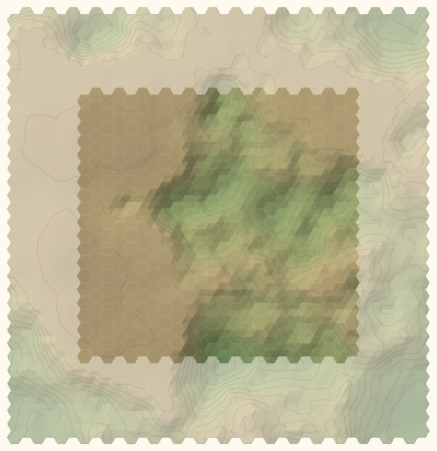

Fractal noise sampled at every corner, over the board *and* its margin:

1. Sum 4 octaves of smoothed white noise. Each octave has half the feature size
   of the previous one and `roughness` × its amplitude.
2. Blend with a **ridged** copy (`1 − |noise|`), which turns zero-crossings into
   sharp ridgelines. `ridges` is the blend amount.
3. Normalise to 0–1, raise to the power 1.5 (flattens lowlands a little), and
   scale to `relief`.

Heights are measured in **hex edge lengths**, so slope is simply the height
difference along an edge.

### 2. Ease of travel

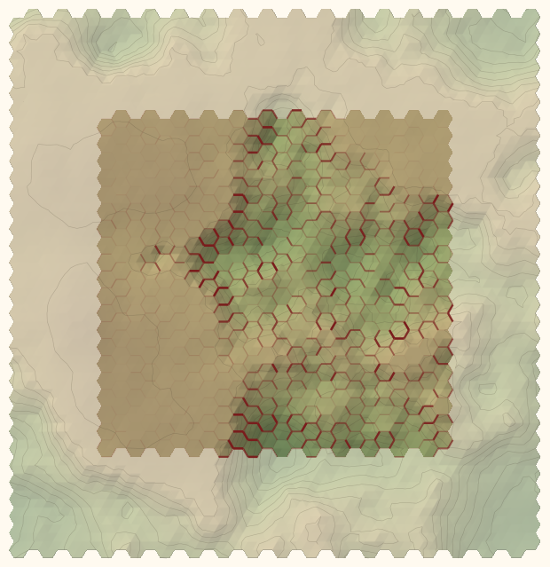

Each edge costs `exp(3.5 × |Δh|)`, a symmetric form of [Tobler's hiking
function.](https://en.wikipedia.org/wiki/Tobler's_hiking_function) Flat ground
costs 1. A rise of 1 edge length over 1 edge costs about 33, so it's steep but
never impassable. Darker red means costlier.

### 3. Node sites

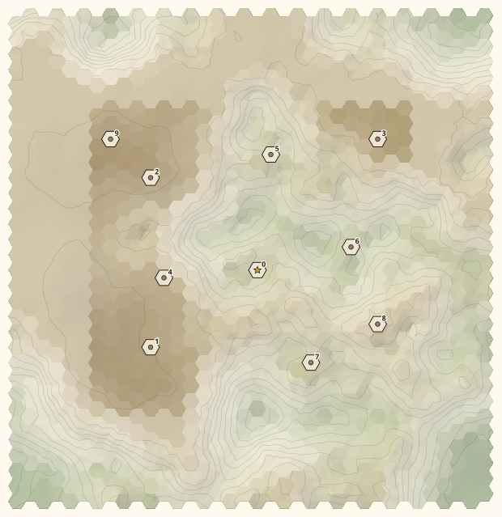

**Suitability** measures how buildable a tile is: `exp(−range / median range)`,
where `range` is the height range over the tile and its 6 neighbours. The fog
covers unsuitable ground.

**Weighted farthest-point sampling** places all `nodes` in one pass. Starting
from spawn (the centre tile), repeatedly take the tile that maximises:

```
distance to nearest placed pad × suitability ^ spread
```

- The board edge counts as a pad at half the distance, so sites don't crowd it.
- Pads stay at least 3 hexes apart while there's room. Past that, spacing just
  tightens.
- `spread` = 0 spaces sites evenly. Higher values pull them onto good ground.

### 4. Teases: escarpments, then levelling

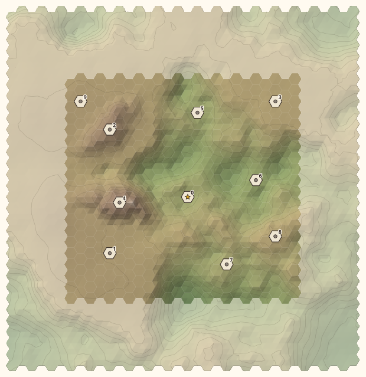

A tease is a **viewer** node that can see a **target** node a long way round on
foot. The target will be typed a POI (§7). The drop-off between them is an
**escarpment**: a steep, wandering edge with the viewer standing at the lip,
looking down.

**Picking pairs.** Find, don't build.
- Any two nodes within 6 hexes. No node is used twice. `teases` sets how many.
- The viewer must be the one **reached first from spawn on foot**. Walking
  order isn't known until trails exist, so the board is generated once without
  escarpments to learn it. The real run uses the same seed, so the sites are
  identical.
- Ranking, best first:
  1. pairs the viewer can **already see**;
  2. then pairs where the ground **already drops** furthest from viewer to
     target (up to the top of `tease_height`, beyond which more drop doesn't
     help);
  3. then the closest pairs.

**Raising the escarpment.**
- Draw a drop from `tease_height` (a range). Raise only the **shortfall**: that
  drop minus the drop the ground already has between the pads. If the ground
  already drops enough, the terrain is untouched.
- The drop sits 1.4 edge lengths in front of the viewer's pad, across the line
  to the target. The viewer's side is raised by the shortfall, falling away
  within 2.5 edge lengths behind.
- The edge wanders, and its height varies along its length, so it blends into
  the terrain.
- Its length is set by `tease_detour`, so that walking around is roughly that
  many times the crow-fly distance. Size is **capped** at 9 edge lengths each
  way along the drop. The guard (§5) enforces the detour on foot either way.
- Visibility is checked from eye height (0.5) at the viewer to a landmark
  (1.5, a roof or post) on the target.

**Levelling (grading).** Each pad's 6 corners are set to their median height.
Around the pad, ground may rise or fall at most 0.5 per edge length away from
the pad edge:
- steeper ground is cut or filled to that grade;
- gentler ground is left alone.

The effect fades out between 1 and 2 edge lengths beyond the pad edge. So on
gentle ground the pad disappears into the terrain, and on steep ground it
becomes a terrace with a graded apron and a step where the grading ends.

### 5. Which nodes to join

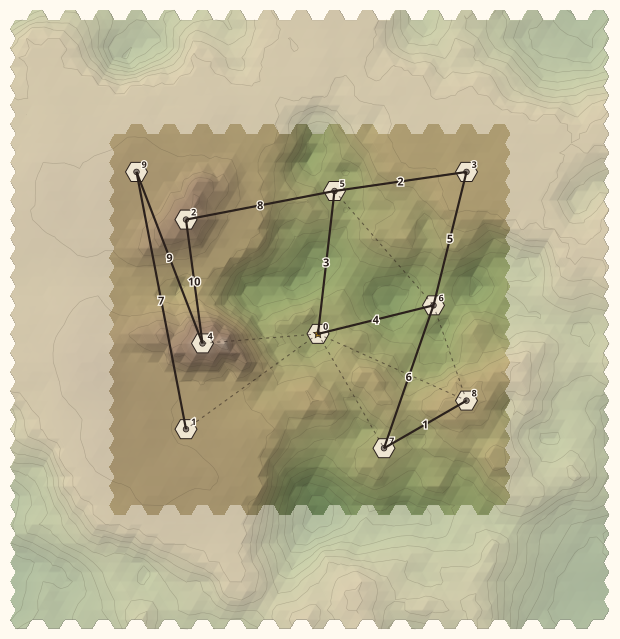

**Greedy spanner.**
1. Compute the **direct cost** between every pair of pads (spawn included):
   the cheapest walk over open terrain.
2. Go through the pairs, cheapest first. Tease pairs are never joined directly.
3. For each pair, build a trail if the existing network makes you walk more
   than 2 × the direct cost.

Solid lines are built trails, numbered in build order. Dashed lines are
skipped pairs.

Each built pair is routed with Dijkstra over the terrain:
- walking an existing trail costs 0.6 ×, so trails **merge**;
- walking right alongside one without joining costs 2.5 ×, so they don't
  **shadow** each other.

**Guarding.** A route is rejected if it breaks more teases than are already
broken. The spanner makes two passes over the pairs, because a pair rejected
early can pass later. For example, a tease target can't connect until its
viewer has.

**Connection pass.** Any node still unconnected is joined to the network. It
tries guarded routes first. Only if none work does it take the cheapest route
regardless, so softlock is impossible.

### 6. Loops

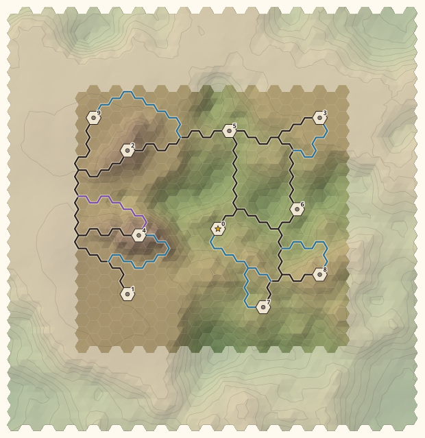

"On a loop" means two separate ways, sharing no trail corner, from the pad to
some other node. Two exits that merge a step later don't count.

Two passes:
1. **Cheap loops.** Spawn always tries. Any other node tries if the new trail
   costs at most 3 × its existing link to its nearest node, and is at most 18
   edges long.
2. **No trees.** Every node still on a spur tries again at any length and
   cost, except tease targets. A tease target has to be far on foot and reached
   after its viewer, so almost any loop near it shortcuts the tease. As a spur
   it's a POI at the end of the long way round, which is the reward.

**With rejoin (current).** The second trail leaves the pad by a fresh corner and
stops at the **first trail it meets**, or at another node:
- it may not touch the node's own spur (the trail out to the first junction),
  and keeps 2 corners clear of it, so the loop isn't a thin finger running
  beside the spur;
- the loop it closes must be at least 14 edges round (new trail plus the walk
  back);
- the same length caps, cost budget and tease guard apply as below.

**Without rejoin (`REJOIN = False`).** Each loop is a second trail **to another
node**:
- The trail is separate: it touches no existing trail except at its two pads.
  Trails can't cross on a honeycomb (a crossing would be a 4-way junction), so
  it can only reach a node around the same enclosed patch of ground. To get
  anywhere else, it has to go around the outside of the whole network, which
  is where the long trails along the board edge came from.
- The loop it closes must be at least 14 edges round: the new trail plus the
  walk back along the network. This replaced "the other node must be 10 edges
  away along the network", which ruled out the best partners, the neighbours
  on a shared trunk.
- Nodes it isn't already directly linked to come first. A second trail to an
  already-linked node (two parallel trails) is the fallback.
- Candidates are tried cheapest first, and each must keep the teases.

If nothing passes, the node stays a spur, and so becomes a POI.

Black trails come from the spanner, blue from cheap loops, purple from the
no-tree pass, and red from the connection pass (none on this board). On this
board, rejoin gives 9, 3, 4, 7 and 8 loops. 1 and 2 stay spurs: 1 is a tease
target, and 2 found no loop that passed every check.

### 7. Typing

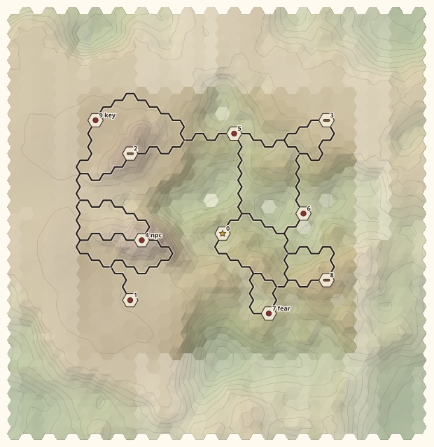

Nodes are typed by where they ended up:
1. **Spurs** and **tease targets** are POIs.
2. The rest are on trails. Going through them in order of bench score (best
   first), each becomes a **bench** unless that would put two benches together
   with no other node (or spawn) between them. Enough nodes are held back as
   POIs for the deck.
3. Everything left is a POI.
4. **Deal the deck:** key, NPC and Fear go to random POIs. Other POIs are empty.

**Bench score** is how well a tile suits a bench. Look at tiles within 6 hexes
from eye height (including the margin):
- **quiet** = 1 − the fraction visible (enclosed: hollows, nooks);
- **overlook** = the fraction that is visible *and* lies below you. Open plains
  don't count, because there's nothing to look out over.

`view` blends the two by rank: 0 is all quiet, 1 is all overlook. The fog
covers low-scoring ground. View now only chooses *which* trail nodes become
benches. It no longer moves where nodes are placed.

### 8. Teases

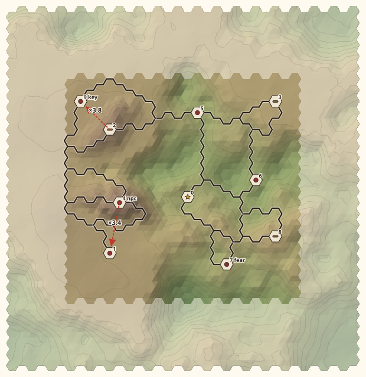

Each arrow points from viewer to target, labelled with walk ÷ crow-fly. Here
node 9 looks down at the NPC (3.8 ×), and node 4 at node 1 (3.5 ×). A failing
tease would be grey and labelled "hidden" or "met late".

### 9. Smoothed

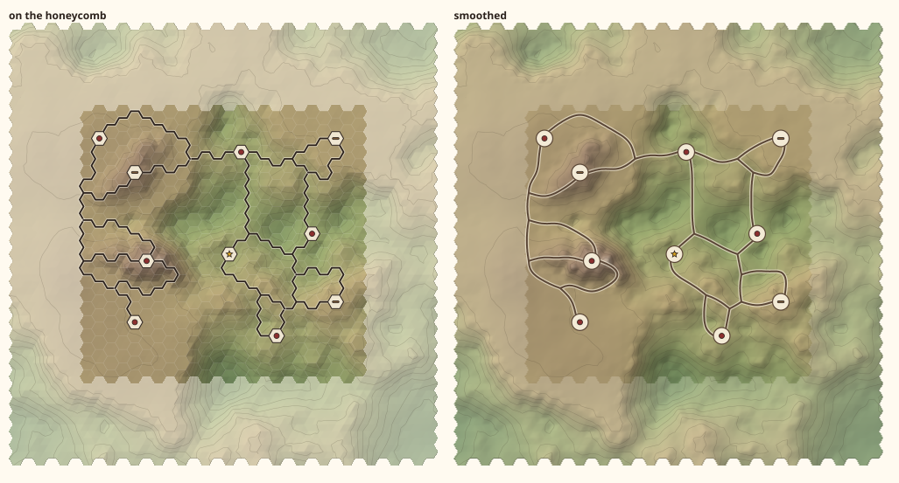

How the final output might look. Trails are split into runs between junctions
and pads. Each run is relaxed (4 passes of neighbour averaging, which removes
the honeycomb zigzag), then corner-rounded (3 passes of [Chaikin's algorithm](https://smarx.com/posts/2020/08/chaikin-curves-a-beautifully-simple-algorithm/)).
Run ends stay put, so runs still meet at junctions.

Terrain here is interpolated smoothly (cubic) instead of per-triangle, and pads
are drawn as round clearings. The zigzag is purely a lattice artefact, so
smoothing doesn't change which ways exist.

## Knobs

| Knob | Default | Effect |
| --- | --- | --- |
| `columns`, `rows` | 24, 20 | Playable board size. |
| `scale` | 8 | Size of hills, in hexes. |
| `relief` | 6 | Total height range, in edge lengths. |
| `roughness` | 0.5 | Small-scale bumpiness (amplitude falloff per octave). |
| `ridges` | 0.3 | Rolling hills → sharp ridgelines. |
| `nodes` | 9 | Nodes to place (typed later). Round 9: replaced by `pois` (6) and `benches` (3). |
| `spread` | 1 | 0 = even spacing; higher = sites follow good ground. |
| `view` | 0.7 | Which trail nodes become benches: 0 = quiet, 1 = overlook. Round 9: where benches are placed. |
| `teases` | 2 | Number of tease pairs. |
| `tease_height` | 2–4 | Escarpment drop, drawn from this range per tease. |
| `tease_detour` | 3 | Minimum walk ÷ crow-fly for a tease. |

The two panel sections would be terrain (`scale` to `ridges`) and network (the
rest).

Internal constants:
- walking and routing: the Tobler factor (3.5), reuse (0.6), alongside (2.5),
  spanner stretch (2), min loop (10 edges), max connector (18 edges) and
  cheap loop (3 × existing link);
- placement: valleys (1.5), grade (0.5), min spacing (3 hexes) and margin
  (6 hexes);
- sight: view radius (6), eye height (0.5), landmark height (1.5) and tease
  sight (6 hexes);
- escarpment reach (9) and back (2.5);
- the deck: key, NPC, Fear.

### Terrain knobs

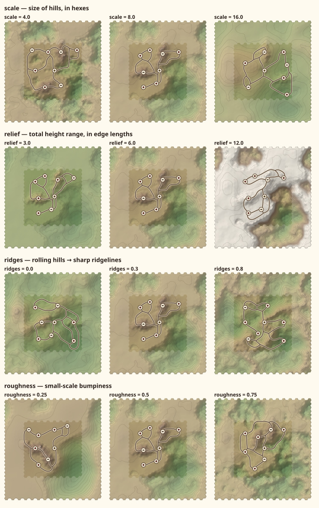

Each row varies one knob at 18 × 15 (7 nodes), with everything else at
defaults, drawn in the final style.

### Network knobs

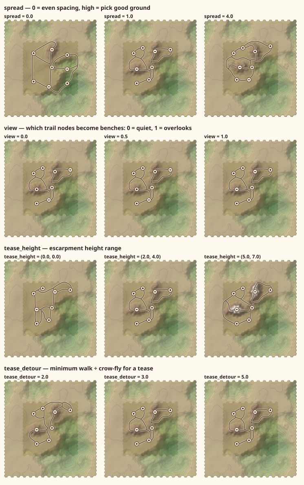

### How much terrain to change

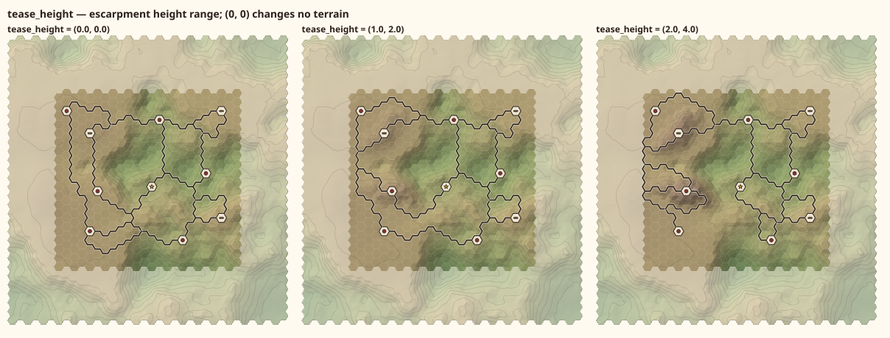

The same board at three `tease_height` ranges. `(0, 0)` changes no terrain for
teases; only pads are graded. Measured in round 5, averaged over seeds 1–12:

| `tease_height` | Corners moved > 0.25 | Mean change | Teases holding |
| --- | --- | --- | --- |
| 0 | 37 (grading only) | 0.03 | 20/23 |
| 1–2 | 74 | 0.06 | 20/23 |
| 2–4 (default) | 97 | 0.09 | 21/23 |

The trail rules do most of the work of keeping a tease. The escarpment mainly
**explains** it, and it makes trails go around naturally. `tease_height` stays a
knob, to be judged in 3D.

### Gallery

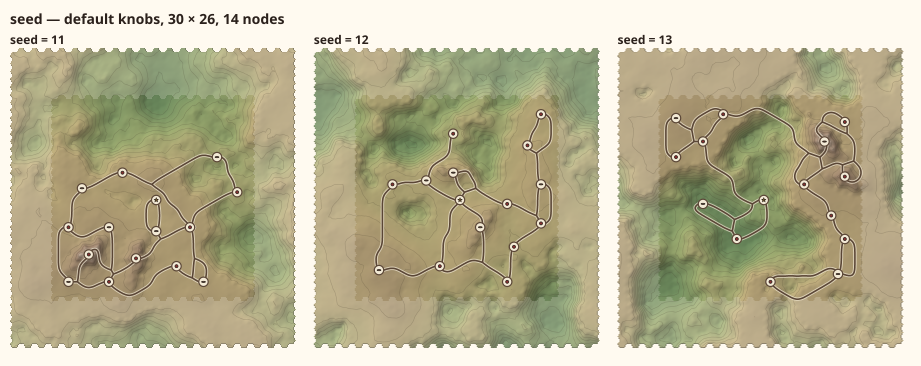

30 × 26, 14 nodes, final style.

## Statistics (1000 seeds)

Default knobs, 24 × 20, 9 nodes, seeds 1–1000. Each board takes about 1 s in
Python (max 2 s). Rerun with
`uv run python -m hexlab.terrain_stats results/terrain/<name>.csv 1000`. One row
per board is written to `misc/hex-lab/results/terrain/`:
`stats-1000.csv` is node-to-node loops only, and `stats-1000-rejoin.csv` is
with rejoin.

### Rejoin vs node-to-node

| Measure | Node-to-node | Rejoin |
| --- | --- | --- |
| Boards with a loop route > 18 edges | 562 | 190 |
| Boards with a loop route > 30 edges | 246 | 21 |
| Longest loop route | 74 | 44 |
| Boards with ≥ 10 loop edges on the outer ring | 455 | 328 |
| Spurs per board | 0.46 | 0.24 |
| Boards with a spur that isn't a tease target | 21 | 20 |
| Independent loops per board (mean) | 4.75 | 5.29 |
| Junctions per board (mean) | 2.6 | 5.6 |
| Benches per board (mean) | 3.32 | 3.09 |
| Trail density (mean) | 0.357 | 0.341 |
| Teases held | 93.3% | 93.3% |
| Spawn on a loop | 99.9% | 99.7% |

Rejoin all but removes the long trails around the edge (over 30 edges: 246 →
21 boards), halves spurs, and adds loops, at the same density. The outer-ring
count stays high because it also counts ordinary short loops between nodes
near the edge, which sit in the outer two rings anyway. Junctions double,
because rejoining makes 3-way junctions along trails. That also costs a few
benches: two benches on one stretch of trail can't both be benches.

Some thin fingers remain in the gallery (two trails close together for a
short stretch), from rejoins that start next to another node's trail.

### Node-to-node loops only

The detail below is for node-to-node loops (`stats-1000.csv`).

| Measure | Result |
| --- | --- |
| Errors | 0 |
| Connected | 100% |
| Spawn on a loop | 99.9% |
| Benches together (no node between) | 0 boards |
| POIs per board | 4–8 (median 6) |
| Benches per board | 1–5 (median 3, mean 3.3) |
| Spurs per board | 0–3 (mean 0.46) |
| Boards with a spur that isn't a tease target | 2.1% |
| Independent loops per board | 2–9 (median 5) |
| Trail density (edges per tile) | 0.21–0.58 (5–95%: 0.26–0.46) |
| Teases placed / held | 1996 / 1862 (93.3%). 100 met late, 101 too short, 1 hidden |
| Boards needing the connection pass | 17.5% |
| Boards using the no-tree pass | 62.3% |
| Corners moved > 0.25 | median 80 (min 2, max 108) |

**Long trails from the no-tree pass do show up.** Its longest route per board
has a median of 28 edges and a maximum of 74. 562 boards have one longer than
the old 18-edge cap, and 246 longer than 30. On 295 boards, 10 or more of its
edges run along the outer ring of the board. It's structural: a trail that
can't cross other trails reaches the far side of the network by going around
the outside of it. Banning the outer ring only moves the route one ring in
(still 199 boards).

Capping the no-tree pass trades rim trails back for spurs:

| No-tree cap | Boards with a non-tease spur | Boards with ≥ 10 no-tree rim edges | Benches per board |
| --- | --- | --- | --- |
| 18 | 629 | 2 | 2.97 |
| 24 | 159 | 134 | 3.35 |
| 30 | 51 | 207 | 3.35 |
| none (current) | 21 | 295 | 3.32 |

The spanner's own routes can run long too: its longest route reaches 68 edges,
and 38 boards have one over 40.

## Quell port

Viewing tools:
- **Toggleable views**, one per measure plus gameplay: heightmap, ease of travel,
  node suitability, bench score, spanner graph, teases, honeycomb trails, types,
  and final (the gameplay state).
- **A real 3D heightmap** to orbit around rather than a 2D render. The mesh
  vertices are the hex corners and centres, exactly the triangles used here.
  Each view is a set of **vertex colours** on that mesh, which is cheaper than
  generating textures and enough for a debug tool.
- **Trails** draped on the mesh as smoothed splines (§9). The honeycomb view
  draws them on the edges.
- **Movement** goes vertex to vertex along trail edges.

## Known issues

1. **The connection pass can break a tease.** It only happens when there's no
   other way to connect a node. That's working as designed, but worth knowing.
2. **Teases cost loops.** Without teases, the same 12 seeds have 16 spurs and
   39 benches; tease targets are spurs by design.
3. **Benches are about a third of nodes** (38 of 108). The "another node
   between two benches" rule caps them at about half of any loop. Bench
   selection is greedy by view score; a selection that maximises the bench
   count would get closer to that cap.
4. **Long trails around the board edge.** With node-to-node loops only, the
   uncapped no-tree pass lays them on about 30% of boards. Rejoin cuts long
   ones (> 30 edges) to 2%. See Statistics.
5. **Thin fingers** still appear occasionally with rejoin.
6. **Escarpments read weakly in 2D.** The 3D view should fix this.

## Open questions

1. **Keep rejoin?** It's on in every figure.
2. **More benches?** Either maximise the bench count under the current rule
   (instead of greedy by view), or relax the rule.
3. **Creeks:** later, as agreed.
