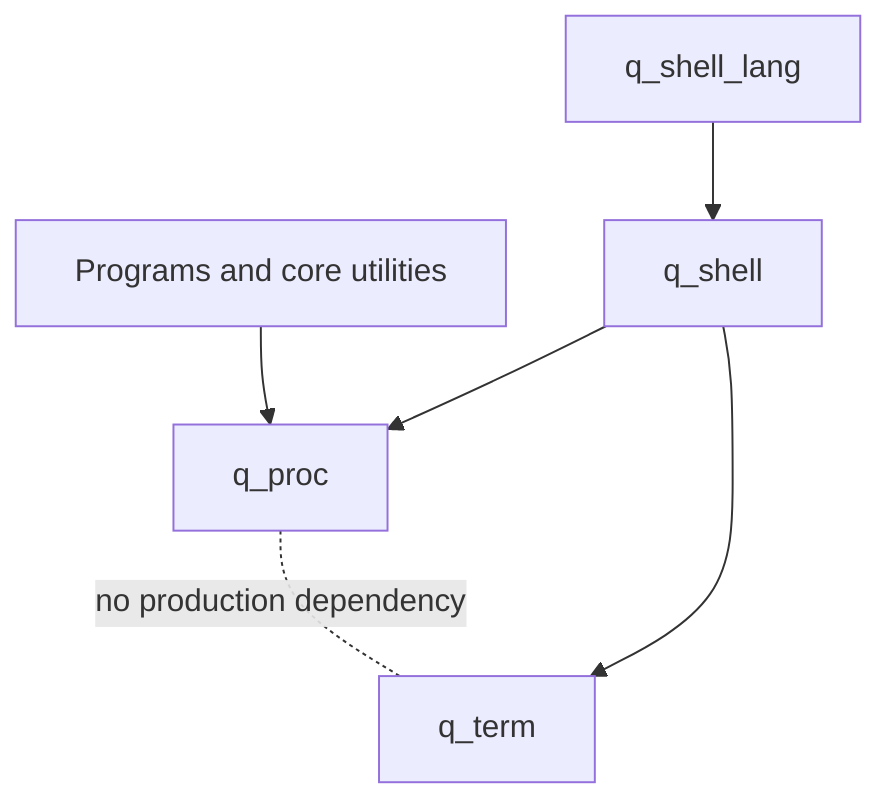
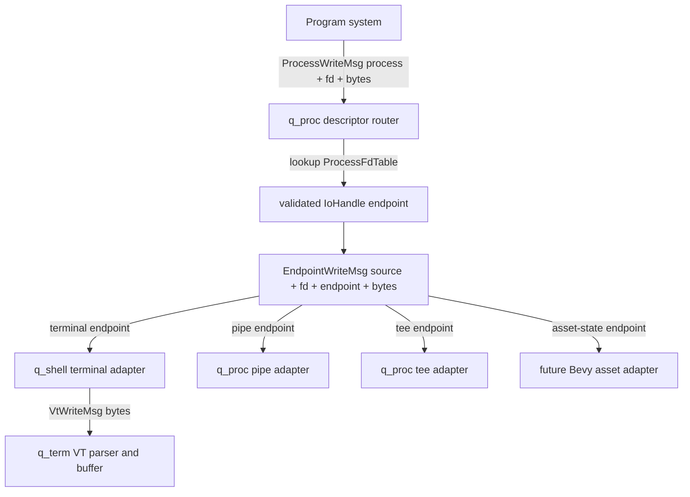
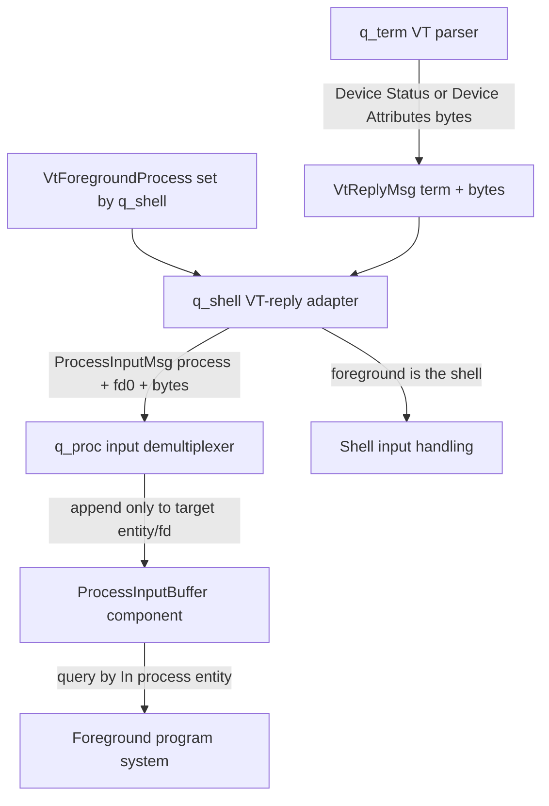
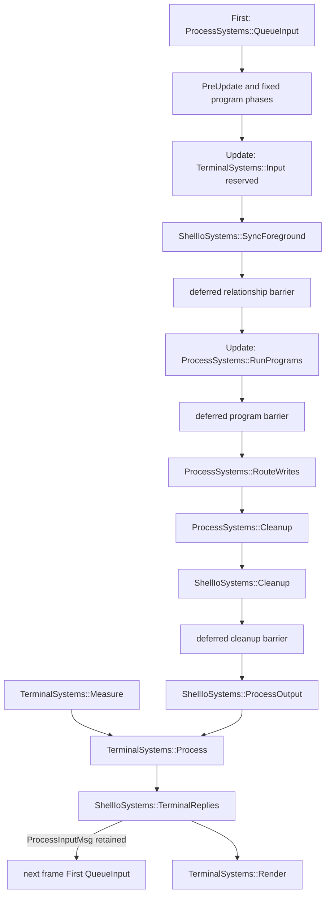

# Process/terminal I/O bridge proposal

Status: **proposal only; no production implementation in this change**

Date: 2026-09-18

Repositories examined:

- `q_shell` at `3c1165314c57fd8ad09fa76a9c0c03fb40bd5b1b` (`feat/initial_migration`)
- `q_proc` at `9a375836636ef63f9b9a107e43a2fd0fa457a455` (`fix/example-vterm`)
- `q_term` at `6f79b84d3e2410c5627e8a2238e2db6853eb8373` (`main`)
- `q_test_harness` local checkout on `fix/cleanup-cruft`
- `../docs/q_os design.md`

“Verified” below means observed in the checked-out source or Git objects. “Recommended” is the proposed architecture. “Inferred” is called out where the history or implementation does not establish intent.

## Executive decision

**Recommended:** put the bridge in `q_shell`, as a distinct exported `ShellTerminalIoPlugin`, rather than in `q_proc`, `q_term`, or a new crate.

This matches the verified dependency graph in `../docs/q_os design.md`, which explicitly describes `q_shell` as the “integration layer between `q_term` and `q_proc`”:



A separate integration crate would only be cleaner if terminal/process integration were useful without shell job control. It is not: selection of the foreground input recipient, descriptor setup, redirection, foreground projection, and terminal-close behavior are shell semantics. A `q_proc_term` crate would either duplicate those semantics or depend on `q_shell`, adding another layer without breaking a cycle. There is already no production dependency cycle.

Keep the integration as a separate plugin inside `q_shell` so consumers can still install shell primitives without installing terminal routing systems. Whether `q_term` is initially an unconditional or feature-gated `q_shell` dependency is a packaging choice; the architecture does not require a fourth crate.

## 1. Current state

### 1.1 `q_proc`

#### Verified

- `Process` is an immutable component with public `fd0`, `fd1`, and `fd2` fields, each a raw `Entity` (`src/data/process.rs`).
- `ProgOutputChannel<const CHANNEL: u8>` contains:
  - `term: Entity`
  - `writes: Vec<String>`
- `StdOut` and `StdErr` are aliases for channels 1 and 2 (`src/data/stdio.rs`).
- `ProcessPlugin` registers `StdOut` and `StdErr`, but no production system in `q_proc` routes or consumes them (`src/plugins.rs`).
- The generic channel keeps stdout and stderr in separate Bevy message resources. This loses a total cross-channel emission order even before routing.
- `StdOut`/`StdErr` do not identify the source process. Inferring the source by finding a process whose `fd1` or `fd2` matches a target is ambiguous when descriptors are shared.
- `fd0` and `fd2` are not read by current `q_proc` production code. `fd1` is read only by the branch-local example/integration test that emits `q_term::TermStdOut` directly.
- A TODO already suggests that descriptors/piping need a stronger abstraction, possibly a `ProcessFd<const CHANNEL: u8>` relationship.
- `ProcessPlugin` installs `run_programs` in six schedules (`PreUpdate`, `Update`, `PostUpdate`, and the three fixed update phases), but exports no public system set.
- `run_programs` queues registered program systems with `Commands::run_system_with`; routing after those systems therefore needs an explicit deferred-command boundary/order contract.
- Signal/default-despawn documentation is ahead of the implementation. There is no current signal consumer or process teardown hook.
- Commit `9a375836636ef63f9b9a107e43a2fd0fa457a455` (`2026-09-17`, `fix: connect program example to terminal`) changed the example from writing `q_proc::StdOut` to writing `q_term::TermStdOut` directly and added `VtForegroundProcess`. This demonstrates the missing bridge, but is not a valid long-term dependency direction for programs.

#### Assessment

The current `StdOut` name is misleading because the type is simultaneously trying to represent a process write, descriptor routing, and terminal ingress. Its `term` field and ANSI-oriented documentation violate the intended process-only abstraction. Raw `Entity` descriptor fields make invalid combinations easy and cannot represent arbitrary descriptors cleanly.

### 1.2 `q_term`

#### Verified

- `TermStdOut` is terminal/VT ingress, despite its name:

  ```rust
  pub struct TermStdOut {
      pub term: Entity,
      pub from: Entity,
      pub message: Vec<TermWrite>,
  }
  ```

- `TermWrite` contains UTF-8 `String` text plus terminal-specific style/reset metadata.
- `process_input` groups messages by terminal, requires a resolvable, non-zero-sized terminal, then accepts only messages whose `from` equals the terminal’s current `VtForegroundProcess`.
- A missing foreground process or a non-foreground sender causes otherwise valid output to be consumed without rendering.
- `q_term` has no stderr ingress type. This is explicit in `src/data/io.rs`.
- `TermStdIn { term, target, message: String }` is produced for VT parser replies such as DSR/DA. `q_term` has no production reader for it.
- `TermInputMsg` models user input at a higher level but is neither registered nor processed by `TerminalPlugin`.
- `TerminalSystems::Input` is public and intentionally reserved for downstream shell-side input handling, but the current outer system chain does not include/configure that set.
- The current actual `Update` order is `Measure -> Process -> Render`; `refresh_ui` also runs in `PostUpdate` in `Render`.
- `TermStdOut` pending storage is currently unbounded despite stale documentation describing a cap.
- `process_input` creates a fresh ANSI parser and performer for each terminal batch. A byte stream split across frames can therefore split an escape sequence or UTF-8 code point, and terminal style/parser state is not demonstrably persistent across batches.
- `VtForegroundProcess` is a one-process-to-one-terminal relationship. It makes `q_term` responsible for process identity and output admission even though `q_term` otherwise has no process model.
- There are no explicit terminal/foreground-process removal hooks or despawn integration tests.

#### Assessment

`TermStdOut` should be named for what it is: a write into a virtual terminal. Its canonical payload should be bytes; Bevy-friendly rich writes can be q_term helpers that encode bytes before ingress. q_term may compare an opaque optional origin with externally maintained `VtForegroundProcess` under a display-policy resource, but it must not infer job state or descriptor routing. `TermStdIn` should be named for its actual role as a terminal-generated reply and should not choose a process target.

### 1.3 `q_shell`

#### Verified

- The README contains only the crate name.
- `Cargo.toml` currently depends on Bevy, `tiny_bail`, and Git `q_proc`; it does not depend on `q_term` or `q_test_harness`.
- The source exports `ShellPlugin`, shell/job/foreground relationship types, and `spawn_process`.
- `spawn_process` copies the shell terminal entity into all three raw descriptor fields and marks every newly spawned process as foreground.
- `ForegroundProcessGroup` can contain multiple process entities, but no current system performs foreground/background transitions or selects an explicit stdin owner.
- `ShellPlugin` registers `ShellSpawnMsg` and runs `spawn_process` directly in `Update`, with no public system set.
- There are no examples.
- `tests/shell/ordering.rs` is a nested file with no top-level integration-test root, so standard Cargo test discovery does not compile it. It also refers to `q_term` without a dependency and writes the old `StdOut` shape.
- The lockfile pins an older `q_proc` snapshot than the current source expects. The checkout is explicitly a WIP migration branch.

#### Assessment

`q_shell` already owns the right concepts—shell-to-terminal attachment, shell jobs, and foreground groups—but has not yet integrated the two lower crates. This is the correct place to establish descriptors, choose a foreground stdin recipient, maintain terminal foreground state, and translate process-neutral bytes to/from VT messages.

## 2. Relevant history

### 2.1 Limitation of the standalone `q_shell` history

#### Verified

A complete search of available `q_shell` refs, log, reflog/object inventory, and unreachable objects found only these meaningful repository commits:

- `3fb9614bd0869c374c35bb63f37d24fa2cda86e8` — `2026-05-24` — `chore: initial commit`
- `3c1165314c57fd8ad09fa76a9c0c03fb40bd5b1b` — `2026-09-15` — `wip: checkpoint before single-checkout migration`

The additional unreachable objects are empty-delta Zed checkpoint commits and contain no older process design. Therefore the requested pre-split design cannot be recovered from the current standalone `q_shell` object database.

The actual lineage survives in `q_term` history, where shell, process, stdio, and terminal code originally lived together. The current `q_shell/src/data/shell.rs` is a reconstruction of that historical shell slice.

### 2.2 Historical milestones verified in `q_term`/`q_proc`

| Commit | Date | Verified significance |
| --- | --- | --- |
| `7e451e1a3c0b8522acb0e05482bfcf2e27f219e6` | 2026-05-25 | Introduced separate stdin/stdout/stderr concepts. |
| `6b440a766f55c283630f28b4619935e21dcd8298` | 2026-05-30 | Added an explicit PTY leader/follower/foreground topology. |
| `d222a2659a34874baafd3d27c18ef83c18802eb9` | 2026-05-30 | Replaced the speculative PTY abstraction with terminal/shell/job relationships. |
| `1ff90909dad45fa245c5ae896dbe91fcf65e4781` | 2026-05-30 | Routed terminal replies toward a foreground job. |
| `1204e3b65f98824b94e219d1e93b3268b303b41a` | 2026-05-31 | Introduced process lifecycle/scheduling and a foreground relationship. |
| `94b3a61aecc9124e6666d640fc1570ce553b0483` | 2026-06-04 | Renamed terminal stdout/stderr types to process-level `StdOut`/`StdErr` and `ProgOutputChannel`. |
| `8618d557620c7277df00aa68812802968ccc583b` | 2026-06-04 | Established `ProgramLabel`, `Process`, raw fd fields, and foreground process group model. |
| `d305719803232f96c83dfd534c296b208f1073e8` | 2026-06-09 | Corrected foreground lookup to use the process-to-shell relationship. |
| `c2099f525d2b8a4d37569c899bb044e81f684011` | 2026-06-09 | Selected the first process from `ForegroundProcessGroup` for terminal replies. |
| `5ce641c3b38f86fc8048038d91aec2c08f525ae8` | 2026-06-15 | First surviving split attempt (`Move proc to q_proc; fixup messages`). |
| `cb5e63d669614dec5c9f273b5f1b01e6ae0b12ed` | 2026-06-24 | Original standalone `q_proc` process primitives. |
| `223ef8c1f82eb8bd2d7909bf3e77c905420db792` | 2026-06-24 | Removed process/shell code from `q_term`; introduced terminal-local `TermStdOut { term, from, ... }` and `VtForegroundProcess`. |
| `6f29fee094c746c2e633eec11fa405a9cf4b7085` | 2026-06-25 | Merged the final extraction into `q_term`. |
| `9a375836636ef63f9b9a107e43a2fd0fa457a455` | 2026-09-17 | Made the `q_proc` example work by bypassing `q_proc` output and emitting `q_term` ingress directly. |

### 2.3 Historical behavior and lessons

#### Verified

Before extraction:

- Shell process spawning assigned the terminal entity directly to `fd0`, `fd1`, and `fd2`.
- `Process::write` targeted `fd1`.
- `Process::write_err` intended to target `fd2` but constructed `StdOut`, demonstrating how the channel-alias design was easy to misuse.
- Nothing used `fd0` for reverse routing; `TermStdIn` carried the selected target process directly.
- `process_input` read stdout and then stderr as separate buffers, merged both into one ANSI parser, and rendered them identically. Reading the buffers separately did not preserve stdout/stderr chronology.
- Output had no source process and was not foreground-filtered before the split.
- Foreground selection affected only terminal reply/input targeting. The group could contain several processes, but the first was chosen; no complete foreground transition implementation existed.
- Pending output retry could lose stderr identity by re-emitting it as stdout.
- The old system ordering intentionally chained terminal processing so messages emitted earlier in the schedule were visible to later readers in the same frame.

#### Inferred

The historical `ForegroundProcessGroup` likely anticipated pipelines or process groups, but the implementation never completed pipe descriptors, foreground switching, terminal access signals, or fd0 routing. It should be treated as useful evidence, not a complete design to restore verbatim.

## 3. Recommended dependency and data flow

### 3.1 Output path



The program-originated message contains the **source process and descriptor number**, not a caller-supplied destination. `q_proc` resolves the destination from that process’s descriptor table. The routed message contains source, fd, destination, and bytes so endpoint adapters can retain provenance and channel identity.

The terminal adapter is physically in `q_shell`: placing it in `q_term` would require the forbidden `q_term -> q_proc` dependency. `q_term` still owns the actual VT endpoint behavior after translation. Generic pipe and tee endpoints belong in `q_proc`; the shell creates/configures them but does not implement their buffering. “Tee” means an explicit endpoint that duplicates one ordered input stream to configured downstream handles.

This proposal does not introduce a VFS or pretend that Unix files map directly onto ECS. If persistent object writes are needed, a future adapter should act on Bevy asset/ECS state through explicit endpoint components and asset handles. The resulting model is closer to an ECS-backed microkernel plus a native textual interface than to a Unix filesystem clone.

This directly prohibits the rejected pattern of searching for a process whose `fd1` matches a terminal.

### 3.2 VT reply and process-input path



`VtForegroundProcess` remains the terminal’s explicit foreground-peer relationship, but `q_shell` establishes and updates it from shell job control. A terminal may have no shell or foreground process and must still render `VtWriteMsg` normally. When a shell is attached but no child job owns the foreground, the shell owns it and receives replies/input itself.

For a foreground pipeline, `q_shell` explicitly chooses the process intended to read terminal fd0 and projects that selection into `VtForegroundProcess`; it does not pick an arbitrary group member or search globally by descriptor target. Before emitting `ProcessInputMsg`, the adapter verifies that the target is still a `Process` and fd0 still refers to that terminal endpoint.

`ProcessInputMsg` is adapter-to-`q_proc` transport, not something every invocation of a shared program system reads directly. A `q_proc` system demultiplexes it into a per-process, per-fd `ProcessInputBuffer` before program execution. This prevents one invocation of a program system from advancing a global `MessageReader` and stealing input intended for another instance of the same program.

**Initial scope:** route VT-generated replies (the role of current `TermStdIn`) back to fd0 and prove actual process consumption. Current and pre-split searches found `LineDiscipline`/`TermInputMsg` data declarations but no registered message, producer, consumer, canonical editor, echo, submit/erase/EOF encoder, or raw-mode system. Host keyboard/user input is therefore a separately ordered follow-up, not part of the first bridge implementation.

## 4. Ownership boundaries

### `q_proc` owns

- Process/program identity and execution.
- Typed descriptor numbers and typed endpoint handles.
- The per-process descriptor table.
- Process-originated write requests.
- Generic descriptor lookup and routed endpoint-write messages.
- Process-targeted input transport and per-process/per-fd input buffers.
- Intrinsic cleanup of `ProcessFdTable`/`ProcessInputBuffer` when `Process` is removed, independent of q_shell.
- Registration/validation of entities that are allowed to become I/O endpoints.
- Generic pipe and tee endpoint behavior, including future wakeup/EOF semantics.
- Generic missing-process, bad-fd, and closed-endpoint diagnostics.
- Public process schedule/system-set contracts.

`q_proc` does **not** know about terminals, ANSI, `TermWrite`, shell foreground groups, keyboard input, or stderr presentation.

### `q_term` owns

- Terminal entities, buffer, viewport, VT parser, terminal UI, and terminal modes.
- Raw byte ingress into a VT.
- A terminal-native rich-write helper that encodes Bevy-friendly style values to ordinary VT/ANSI bytes before ingress; structured spans are not a second transport protocol.
- Terminal-generated reply bytes: Device Status Report (DSR), Device Attributes (DA), and future protocol replies.
- The `VtForegroundProcess` relationship as terminal state exposed for an external owner to set.
- Pending terminal ingress/backpressure policy.
- Public terminal schedule/system-set contracts.

`q_term` does **not** decide job foreground/background transitions, what fd produced bytes, or what stderr means. It exposes/queries `VtForegroundProcess`, applies its configured terminal display policy to writes carrying optional origin metadata, and relies on `q_shell` to keep the relationship current.

### `q_shell` owns

- Shell-to-terminal attachment.
- Shell/job relationship cleanup when `Process` is removed; generic process I/O teardown remains in q_proc.
- Job/process-group membership and foreground/background transitions.
- Explicit selection of the foreground stdin recipient and synchronization of `VtForegroundProcess`.
- Initial descriptor table construction and redirection/pipeline configuration.
- Terminal endpoint adapter: `EndpointWriteMsg -> VtWriteMsg`.
- VT-reply adapter: `VtReplyMsg -> ProcessInputMsg` or shell input handling.
- Terminal-close/HUP policy.

### Future asset-state adapters own

- Translation from `EndpointWriteMsg` into mutations of explicit Bevy asset/ECS state.
- Asset lookup/loading/error behavior; not a speculative VFS.

The shell configures endpoints; it should not implement every endpoint. Generic pipe and tee adapters belong in `q_proc`. One fd maps to one `IoHandle`. Fan-out is represented by a tee endpoint, not by placing a vector of destinations in every write message.

## 5. Proposed types

Names are sketches; visibility and exact collection choice can be refined during implementation.

### 5.1 `q_proc`: descriptors and writes

```rust
/// A process-local descriptor number.
#[derive(Clone, Copy, Debug, Eq, Hash, Ord, PartialEq, PartialOrd, Reflect)]
pub struct FileDescriptor(u16);

impl FileDescriptor {
    pub const STDIN: Self = Self(0);
    pub const STDOUT: Self = Self(1);
    pub const STDERR: Self = Self(2);
}

/// Implemented by component types that make an entity I/O-capable.
pub trait IoComponent: Component {}

/// Global registry populated by each endpoint plugin.
#[derive(Resource, Deref, DerefMut, Default)]
pub struct IoComponentCache(HashSet<TypeId>);

pub trait RegisterIoAppExt {
    fn register_io_component<T: IoComponent>(&mut self) -> &mut Self;
}

/// Runtime-typed reference to one registered I/O capability on an entity.
/// Construction is private and validated against IoComponentCache.
#[derive(Clone, Copy, Debug, Eq, Hash, PartialEq)]
pub struct IoHandle {
    entity: Entity,
    component: TypeId,
}

/// Mutable independently of the immutable Process identity/configuration.
#[derive(Component, Clone, Debug, Default, Reflect)]
pub struct ProcessFdTable {
    descriptors: HashMap<FileDescriptor, IoHandle>,
}

impl ProcessFdTable {
    pub fn get(&self, fd: FileDescriptor) -> Option<IoHandle>;
    pub fn set(&mut self, fd: FileDescriptor, handle: IoHandle) -> Option<IoHandle>;
    pub fn close(&mut self, fd: FileDescriptor) -> Option<IoHandle>;
    pub fn duplicate(&mut self, from: FileDescriptor, to: FileDescriptor) -> Result<(), BadFd>;
}

/// A write requested by a program through one of its descriptors.
#[derive(Message, Clone, Debug, Reflect)]
pub struct ProcessWriteMsg {
    pub process: Entity,
    pub fd: FileDescriptor,
    pub bytes: Vec<u8>,
}

/// Output of q_proc descriptor resolution, consumed by endpoint adapters.
#[derive(Message, Clone, Debug, Reflect)]
pub struct EndpointWriteMsg {
    pub process: Entity,
    pub fd: FileDescriptor,
    pub endpoint: IoHandle,
    pub bytes: Vec<u8>,
}

/// Bytes made available to one process descriptor by an endpoint adapter.
#[derive(Message, Clone, Debug, Reflect)]
pub struct ProcessInputMsg {
    pub process: Entity,
    pub fd: FileDescriptor,
    pub endpoint: IoHandle,
    pub bytes: Vec<u8>,
}

/// Process-local input, populated by q_proc before this process runs.
#[derive(Component, Clone, Debug, Default, Reflect)]
pub struct ProcessInputBuffer {
    queues: HashMap<FileDescriptor, VecDeque<u8>>,
}
```

`q_proc` exposes `RegisterIoAppExt::register_io_component<T: IoComponent>()`, which initializes a global `IoComponentCache` and inserts `TypeId::of::<T>()`. Each endpoint plugin defines its capability component, implements `IoComponent`, registers that type, and installs its adapter systems. For example, q_shell defines/registers a `TerminalIoEndpoint` component attached to q_term terminal entities; this avoids requiring q_term to depend on q_proc. q_proc similarly defines/registers its pipe and tee components.

`IoHandle` has no public unchecked constructor. Handle creation selects one component type present in `IoComponentCache` and stores both the entity and that `TypeId`. Routing validates that exact registered capability and dispatches only to its adapter. If the entity is despawned or loses the selected component, the handle is closed even if another registered I/O component remains on the entity. This is a runtime guarantee—as ECS components can be removed dynamically—but it prevents arbitrary entities from becoming handles by convention alone.

Including the selected capability prevents accidental fan-out when one entity carries several registered I/O components and prevents endpoint type changes from silently retargeting an existing descriptor. Fan-out still requires an explicit tee handle.

The public API must include `IoHandle::entity()` and `IoHandle::component_type_id()` for adapter queries plus fd-table `get`/`set`/`close`/`duplicate` operations.

**Canonical process-output type:** `ProcessWriteMsg`.

Why:

- “Write” describes the operation without claiming the destination is a terminal or the descriptor is stdout.
- The source process is explicit.
- The fd is explicit, so stdout/stderr remain distinct in one ordered message stream.
- The destination cannot be forged or become stale at the producer call site; it is resolved from `ProcessFdTable`.
- `EndpointWriteMsg` exposes the resolved destination to adapters without making programs know endpoint details.

`fd0`/`fd1`/`fd2: Entity` should move out of `Process` and be replaced by `ProcessFdTable`. A const-generic relationship works for three fixed descriptors but does not scale to arbitrary descriptors, `dup`, or runtime redirection. A typed table plus registered component-capability cache is the smaller general solution.

The fd table is separate from immutable `Process` so redirection/close/dup operations do not require replacing process identity/configuration. `ProcessInputBuffer` is also process-local: each `In<Entity>` program invocation queries and drains only its own component, so multiple processes registered to the same `SystemId` cannot steal each other’s input.

### 5.2 Payload type

**Recommended:** canonical `q_proc` I/O carries `Vec<u8>`.

Reasons:

- Process streams and ANSI/VT protocols are byte streams, not guaranteed UTF-8 strings.
- UTF-8 decoding is a terminal/parser concern.
- Structured spans and `TermWrite` encode presentation and must remain terminal-specific.
- Arbitrary chunk boundaries require `q_term` to persist parser/UTF-8 state per terminal rather than assuming each process write is a complete string.

Use the standard `Vec<u8>` initially rather than adding a bytes crate. Convenience constructors may accept `str`/`String` and copy `as_bytes()`.

### 5.3 `q_term`: terminal ingress and replies

```rust
/// Raw bytes addressed to a virtual terminal.
#[derive(Message, Clone, Debug, Reflect)]
pub struct VtWriteMsg {
    pub term: Entity,
    /// Optional source peer. None is a terminal-native/direct write.
    pub from: Option<Entity>,
    pub bytes: Vec<u8>,
}

/// q_term plugin resource controlling non-foreground write admission.
#[derive(Resource, Clone, Copy, Debug, Default, Reflect)]
pub enum BackgroundTerminalOutput {
    #[default]
    Allow,
    Suppress,
}

/// Bytes generated by the VT protocol in response to ingress.
#[derive(Message, Clone, Debug, Reflect)]
pub struct VtReplyMsg {
    pub term: Entity,
    pub bytes: Vec<u8>,
}
```

Rename recommendations:

- `TermStdOut` -> `VtWriteMsg`
- `TermStdIn` -> `VtReplyMsg`

`VtWriteMsg` has no fd and no required process source. `q_shell` translates `EndpointWriteMsg.process` into `from: Some(process)`; terminal-native/direct writes use `None`. A standalone terminal with no `VtForegroundProcess` renders normally. With a foreground peer, q_term’s `BackgroundTerminalOutput` resource decides whether a different `Some(from)` is rendered. `Allow` is the default. This is terminal plugin configuration; q_shell selects the foreground peer but does not own the display setting.

Use one byte transport rather than mixing raw and structured variants. `TermWrite` may remain as a Bevy-friendly authoring helper, but a q_term helper converts its foreground/background/style fields to ANSI bytes before emitting `VtWriteMsg`; it is not itself the wire payload. This preserves one total ingress order and lets TUI authors use Bevy color/style values without making programs depend on `q_term`.

`q_term` needs persistent per-terminal parser **and rendition state** before arbitrary chunks are safe. Persisting only `AnsiParser<Utf8Parser>` is insufficient: a complete SGR color sequence in frame N must still affect ordinary text in frame N+1.

### 5.4 `q_shell`: foreground projection

`ForegroundProcessGroup` remains the process-group/job-control source of truth. `q_shell` explicitly chooses the input recipient—one pipeline member, or the shell itself when no child process owns the foreground—and maintains the existing `q_term::VtForegroundProcess` relationship on that entity. `VtForegroundProcess` stays. q_term combines that externally maintained relationship with its own `BackgroundTerminalOutput` resource; the default changes from today’s implicit suppression to explicit `Allow`.

## 6. Stdout, stderr, redirection, and background output

### Stdout versus stderr

- Programs write `ProcessWriteMsg` with fd 1 or fd 2.
- One message type preserves cross-fd order as far as Bevy system execution itself is ordered.
- `q_proc` resolves each fd independently, so stdout and stderr may point to the same terminal, different asset-state endpoints, pipes, or closed handles.
- `EndpointWriteMsg.fd` retains channel identity until the endpoint adapter.
- The terminal adapter may render both into the same VT byte stream, but that merge is an explicit endpoint decision.
- Default terminal rendering should not style stderr specially. Optional stderr styling belongs to `q_shell` adapter configuration and must not enter `q_proc`.

### Redirection, pipes, assets, and fan-out

- Each endpoint plugin registers its `IoComponent` type in q_proc’s global cache; q_shell attaches its registered `TerminalIoEndpoint` capability to terminal entities and populates `ProcessFdTable` at spawn.
- Redirection updates the fd table; programs continue writing process+fd.
- `q_proc` performs generic fd-to-handle lookup and validates that the target entity still carries the exact registered I/O-capable component selected by that handle.
- Generic pipe and tee adapters live in `q_proc`; q_shell configures their topology.
- A pipe adapter queues bytes for its reader and ultimately feeds that process’s input buffer. Full pipe support needs bounded capacity plus wakeup/EOF semantics, not terminal-style eviction.
- A future asset adapter consumes `EndpointWriteMsg` for an endpoint carrying explicit Bevy asset state/handles. A VFS is a non-goal.
- Closing/duplicating descriptors is an operation on `ProcessFdTable`/handles, not a terminal operation.
- Fan-out is an explicit q_proc tee endpoint. It is not an implicit `Vec<Entity>` destination field.

### Foreground/background output

**Recommended default:** background process output is rendered if its resolved descriptor actually points to the terminal. This matches common Unix terminal behavior and respects descriptor routing.

`BackgroundTerminalOutput` is a q_term plugin resource. `Allow` renders all addressed writes; `Suppress` compares `VtWriteMsg.from` with the externally maintained `VtForegroundProcess` and drops non-foreground writes. Direct `from: None` writes and writes to a terminal with no foreground peer remain renderable. q_shell supplies source metadata during translation but does not apply the resource. Future TOSTOP/SIGTTOU behavior requires separate q_shell/q_proc signal design; it is not a q_term display-resource variant. Foreground status controls input and terminal-generated replies; it is not intrinsically ownership of stdout/stderr.

## 7. Plugins, systems, sets, and ordering

### 7.1 Plugins

- `q_proc::ProcessPlugin`
  - registers process I/O messages;
  - demultiplexes `ProcessInputMsg` into target-local `ProcessInputBuffer` components once in `First`;
  - exports/configures `ProcessSystems::RunPrograms -> RouteWrites` in every schedule where program systems run;
  - resolves `ProcessWriteMsg` after program execution;
  - hosts generic pipe/tee endpoint adapters (individually installable if preferable).
- `q_term::TerminalPlugin`
  - registers `VtWriteMsg` and `VtReplyMsg` and initializes configurable `BackgroundTerminalOutput` (`Allow` by default);
  - includes the reserved `TerminalSystems::Input` in its public ordered set contract;
  - parses VT ingress, applies display admission, and emits replies without choosing job-control state.
- `q_shell::ShellPlugin`
  - owns shell/job spawning and foreground state.
- `q_shell::ShellTerminalIoPlugin`
  - requires the three core plugins or documents them as prerequisites;
  - synchronizes `VtForegroundProcess`, translates terminal endpoint writes, and routes VT replies;
  - exports `ShellIoSystems`.

Host keyboard/line-discipline systems are not part of the initial `ShellTerminalIoPlugin`; they may later occupy the reserved `TerminalSystems::Input` phase.

### 7.2 Sets

Sketch:

```rust
#[derive(SystemSet, Debug, Clone, Copy, Eq, Hash, PartialEq)]
pub enum ProcessSystems {
    QueueInput,
    RunPrograms,
    RouteWrites,
    Cleanup,
}

#[derive(SystemSet, Debug, Clone, Copy, Eq, Hash, PartialEq)]
pub enum ShellSystems {
    Spawn,
    Foreground,
}

#[derive(SystemSet, Debug, Clone, Copy, Eq, Hash, PartialEq)]
pub enum ShellIoSystems {
    SyncForeground,
    ProcessOutput,
    TerminalReplies,
    Cleanup,
}
```

### 7.3 `Update` ordering



Required contracts:

1. `q_term` explicitly configures `TerminalSystems::Input -> Measure -> Process -> Render`; enum declaration order alone is not sufficient. The initial bridge leaves `Input` empty but preserves the slot for future host-input producers.
2. `ProcessSystems::QueueInput` runs **once in `First`**, before every supported program phase. It drains the global transport and appends each message only to the target process/fd inbox; program invocations never own a global input reader.
3. `q_shell` explicitly chains foreground mutation/synchronization, an `apply_deferred` barrier, then any consumer that queries `VtForegroundProcess`. A foreground switch queued in this phase is visible before reply routing later in the same `Update`.
4. In each program schedule, `ProcessSystems::RunPrograms -> apply_deferred -> RouteWrites -> Cleanup` is explicit. Routing precedes cleanup so bytes written before process exit can still reach their endpoint; q_proc cleanup then closes process-local I/O state.
5. In `Update`, `ProcessSystems::Cleanup -> ShellIoSystems::Cleanup -> apply_deferred -> ShellIoSystems::ProcessOutput -> TerminalSystems::Process` is explicit. Shell cleanup removes/retargets stale foreground relationships before q_term evaluates `Suppress`, including when an Update program removes its own `Process` component.
6. `ShellIoSystems::TerminalReplies` runs after VT processing and before terminal render. Replies become `ProcessInputMsg` in frame N, are demultiplexed in `First` of frame N+1, and are available to `PreUpdate`, fixed, `Update`, and `PostUpdate` program phases on their first execution after that point. This avoids schedule-dependent demultiplexing and a schedule cycle.
7. When host input is implemented later, its encoding/delivery latency needs its own decision. It must not be implied by sharing `TerminalSystems::Input`; the current first bridge guarantees next-frame delivery only for VT replies.
8. Output emitted in `PreUpdate`, fixed phases, or `Update` is admitted during that frame’s `Update`. Output emitted in `PostUpdate` is rendered in the following `Update`. Tests document this latency rather than relying on incidental message retention.

Plugins that own a schedule phase should follow project convention and permit schedule relocation where practical. Cross-crate consumers order against exported sets, never private system function names.

## 8. Foreground and lifecycle semantics

### Foreground source of truth

- `q_shell::ForegroundProcessGroup` is the job-control source of truth.
- `VtForegroundProcess` stays as q_term’s explicit foreground-peer relationship; `q_shell` establishes and updates it during spawn, foreground, background, and completion transitions.
- For a foreground pipeline, q_shell selects one process whose fd0 is the terminal input endpoint and places `VtForegroundProcess` on that entity. It does not infer this from fd1 or group order.
- If no child process owns the foreground, q_shell places/maintains the relationship on the shell so shell input handling receives replies. No placeholder entity is emitted.
- A standalone terminal may have no `VtForegroundProcess` and still accepts/renders `VtWriteMsg`.

### Process removal

- Removing the `Process` component defines process death even if the entity remains alive. Cleanup must therefore react to both `Process` removal and entity despawn.
- On either path, q_proc intrinsically removes/closes `ProcessFdTable` and `ProcessInputBuffer`; this behavior must work without q_shell installed.
- q_shell separately removes stale `ShellJob`/`ForegroundProcess` membership and clears or retargets `VtForegroundProcess`.
- Removing `ProcessFdTable` from a live process closes all descriptors and prevents further routing.
- q_shell translates a routed endpoint write to `VtWriteMsg` with source metadata. q_term then applies its current `BackgroundTerminalOutput` resource. Under `Allow`, the write may drain after source removal; under `Suppress`, it must still match the terminal’s foreground relationship when processed.
- `ProcessFdTable` is the short-lived routing capability during ordered teardown. If a program emits `ProcessWriteMsg` and removes `Process` in the same invocation, `RouteWrites` may resolve that write from the still-present fd table; `ProcessSystems::Cleanup` closes/removes the table immediately afterward. Once the table is gone, later writes are discarded with a warning. Logging is sufficient for the first implementation.

### Endpoint/terminal removal

- `q_proc` treats either entity despawn **or removal of the exact registered `IoComponent` selected by an `IoHandle`** as handle closure. Other I/O-capable components on that entity do not retarget the handle. q_proc does not panic or issue entity commands against the invalid endpoint; matching descriptors close and failed writes are logged initially.
- `Terminal` is an immutable root identity whose required components live on the same entity. Closing a terminal means despawning that entity; removing and reinserting only the marker is unsupported.
- Linked-spawn terminal buffer relationships ensure terminal-owned line, row, and viewport entities are despawned with the terminal.
- `q_shell` removes `VtForegroundProcess` state and stops routing when the terminal entity is despawned or its separate `TerminalIoEndpoint` capability is removed.
- Closing a controlling terminal sends `SIGHUP` to its shell/jobs. Until q_proc signal behavior is implemented, the minimum safe behavior is deterministic descriptor/relationship cleanup plus a warning—never silent dangling handles.
- A process whose terminal endpoint disappears subsequently receives EOF/closed-endpoint behavior on reads and logged write failure; a correlated syscall-like return API is deferred.

### Missing or not-yet-ready terminals

- A live terminal without the explicit `VtReady` marker may queue ingress. `VtReady` is maintained from terminal measurement state; absence of `Terminal` means closed rather than pending.
- Use the historically intended default cap of 1 MiB per terminal. Store whole incoming byte chunks in FIFO order; on overflow evict oldest whole chunks and emit one summarized warning per insertion. This is a terminal pending-display policy, not a pipe policy.
- Pipe queues require bounded blocking/wakeup/EOF semantics and must not reuse terminal eviction.
- A nonexistent terminal is not “pending”; it is closed and messages are discarded/logged.

## 9. Staged cross-repository migration

Use a coordinated breaking cutover. This is a research project with no live consumers, so duplicate compatibility APIs would create two descriptor sources of truth and more risk than value. `q_term` and `q_proc` can be developed independently, but their breaking commits must exist before `q_shell` lands.

### Stage 0: baseline/coordination (no API implementation)

1. Adopt the review decisions recorded in Section 11.
2. Develop against local `q_proc`/`q_term` branches so the q_shell lock resolves those local changes; before pushing, restore Git dependencies to each upstream repository’s `main` branch and regenerate the lock.
3. Add/fix the q_shell test root and dependencies as part of the integration branch; these are known baseline repairs, not unresolved architecture.

### Stage 1: `q_term` breaking terminal-boundary API

Must land before `q_shell` integration.

1. Replace `TermStdOut` with byte-only `VtWriteMsg` and replace `TermStdIn` with `VtReplyMsg`.
2. Keep `VtForegroundProcess`; add optional `VtWriteMsg.from` and configurable `BackgroundTerminalOutput` resource with `Allow` default and `Suppress` behavior. A terminal does not require a foreground peer to render.
3. Keep a Bevy-friendly `TermWrite` authoring helper only if it encodes to ANSI bytes before `VtWriteMsg`; do not retain structured spans as a second ingress transport.
4. Persist ANSI parser, UTF-8 decoder, and rendition/style state per terminal across messages/frames.
5. Emit replies with terminal identity only; q_shell queries the externally maintained foreground relationship.
6. Put the reserved `TerminalSystems::Input` into the explicit ordered set chain, but do not implement host line discipline yet.
7. Restore a byte-capped 1 MiB pending FIFO with whole-chunk eviction/warnings; add explicit `VtReady` state, immutable terminal identity, and linked-spawn cleanup on terminal despawn.
8. Remove the old types in the same cutover; there is no compatibility adapter.

Validation in `q_term`:

- focused tests with `cargo nextest run <filter>`;
- full `qproj-scripts check q_term`;
- full `qproj-scripts test`.

### Stage 2: `q_proc` breaking process-I/O API

Can be developed in parallel with Stage 1, but must land before Stage 3.

1. Add `FileDescriptor`, `IoComponent`, global `IoComponentCache`, `RegisterIoAppExt`, validated `IoHandle`, `ProcessFdTable`, `ProcessWriteMsg`, `EndpointWriteMsg`, `ProcessInputMsg`, and `ProcessInputBuffer`.
2. Add one `ProcessSystems::QueueInput` pass in `First`; add `RunPrograms -> RouteWrites -> Cleanup` ordering and intrinsic process-I/O teardown in each supported program schedule.
3. Add `IoHandle::entity()`/`component_type_id()` plus fd-table get/set/close/duplicate and stdout/stderr convenience constructors without separate message resources.
4. Log missing process/fd/endpoint writes in the first implementation. A “syscall-like return channel” would be a future correlated success/error result delivered to the requesting program; it is unnecessary until programs need to react to write failure.
5. Put generic pipe and tee endpoint adapters in q_proc; pipe wakeup/blocking can be staged behind the basic endpoint contract.
6. Move the terminal integration example/test out of q_proc; q_proc examples emit only `ProcessWriteMsg`.
7. Remove raw `Process::fd0/fd1/fd2`, `ProgOutputChannel`, `StdOut`, and `StdErr` in this cutover. Do not add a production q_term dependency.

Validation in `q_proc`:

- focused tests with `cargo nextest run <filter>`;
- full `qproj-scripts check q_proc`;
- full `qproj-scripts test`.

### Stage 3: `q_shell` integration

Lands after the Stage 1 and Stage 2 commit pins exist.

1. Use local branch dependencies during development; before push, point q_proc/q_term Git dependencies back at upstream `main` and regenerate the lock. Add `q_test_harness` as a dev dependency.
2. Add public `ShellSystems` and `ShellIoSystems` contracts with explicit foreground and removal-cleanup barriers before terminal processing.
3. Add explicit foreground transition logic that maintains `ForegroundProcessGroup` and `VtForegroundProcess`; the shell is the foreground peer when no child process is.
4. Change spawning to construct `ProcessFdTable` with fd 0/1/2 pointing at a validated terminal endpoint handle.
5. Add `ShellTerminalIoPlugin` for process output and VT-reply routing. Host keyboard/line-discipline routing is explicitly deferred.
6. Populate `VtWriteMsg.from` in q_shell; configure `q_term::BackgroundTerminalOutput` (`Allow` by default) in applications/tests.
7. Replace the orphaned nested test with a discovered top-level integration test harness.
8. Add process-component, terminal-entity, and endpoint-capability cleanup plus controlling-terminal HUP behavior.

Validation in `q_shell`:

- focused bridge tests with `cargo nextest run <filter>`;
- `qproj-scripts check q_shell`;
- `qproj-scripts test`.

### Stage 4: downstream cutover

1. Update programs/core utilities to emit `ProcessWriteMsg`, never q_term types.
2. Update terminal-native examples to use byte `VtWriteMsg` (or the q_term rich-write-to-ANSI helper) only when demonstrating q_term itself.
3. Update shell language/coreutils callers and redirection code.
4. Validate each changed repository with `qproj-scripts check <package>` and `qproj-scripts test`.

No compatibility-removal stage follows: old process/terminal I/O types are removed in Stages 1 and 2. `VtForegroundProcess` remains.

## 10. Test plan with `q_test_harness`

Use `TestRunnerPlugin`’s default single-threaded executor for deterministic schedule assertions, `add_step` for eventual UI state, and `CommandsExt::assert` inside systems. Do not use direct `cargo test`; use focused Cargo Nextest and full `qproj-scripts test`.

### `q_proc` tests

1. **Descriptor routing**
   - Spawn a process with fd1 mapped to endpoint A.
   - Emit `ProcessWriteMsg::stdout(process, b"x")`.
   - Assert one `EndpointWriteMsg` with source process, fd1, endpoint A, and unchanged bytes.

2. **stdout/stderr identity and order**
   - Emit fd1 `a`, fd2 `b`, fd1 `c` from one ordered program system.
   - Assert routed messages remain `1:a, 2:b, 1:c`.

3. **multiple processes/shared endpoint**
   - Map two processes’ fd1 to the same endpoint.
   - Assert routed messages retain distinct explicit source IDs; no reverse lookup is used.

4. **redirection**
   - Map fd1 to an asset-state test endpoint and fd2 to a terminal-like endpoint.
   - Assert independent destinations.

5. **per-process input isolation**
   - Register one program system and spawn two instances of it.
   - Deliver different `ProcessInputMsg` bytes to each process.
   - Run `QueueInput` and the shared program system; assert each invocation consumes only its own `ProcessInputBuffer` and neither steals the other message.

6. **missing/removed/despawned state**
   - Missing process, missing fd, removed `ProcessFdTable`, removal of the registered `IoComponent` selected by the handle, and despawned endpoint each log the specified failure and produce no invalid routed write.
   - Put two registered I/O capabilities on one entity; assert a handle selects only one adapter, removing that selected component closes it, and the other component never creates implicit fan-out/retargeting.
   - In one program invocation, emit output and remove `Process`; assert `RouteWrites` uses the teardown fd table for that final write, then `Cleanup` closes/removes `ProcessFdTable` and `ProcessInputBuffer` without q_shell installed.
   - A write emitted after cleanup cannot use the removed process’s old descriptors.

### `q_term` tests

1. Byte `VtWriteMsg` reaches the terminal buffer without any process/foreground component.
2. Raw bytes split in the middle of an ANSI escape sequence across frames parse correctly.
3. Raw bytes split in the middle of a multibyte UTF-8 code point parse according to the chosen invalid/incomplete-byte policy.
4. A complete SGR color sequence in one frame still affects text written in the next frame.
5. The Bevy-friendly rich-write helper encodes ANSI bytes and preserves ordering with adjacent raw byte writes.
6. Device Status Report/Device Attributes queries emit `VtReplyMsg { term, bytes }` without a process target.
7. Pending ingress obeys the 1 MiB whole-chunk FIFO eviction policy.
8. Despawning a terminal clears pending state and recursively despawns terminal-owned buffer entities; writes to non-terminal entities are closed rather than pending.

### `q_shell` end-to-end tests

1. **process stdout reaches terminal buffer**
   - An `Update` program emits fd1 bytes.
   - Assert terminal text and, separately, a redraw observed after terminal processing in the same frame.

2. **stderr routing**
   - fd2 mapped to the same terminal renders bytes.
   - A bridge-level probe confirms it arrived as fd2 before VT translation.
   - A redirected fd2 does not appear in the terminal.

3. **foreground output accepted**
   - Foreground process fd1 output renders.
   - This protects the normal job path during removal of current q_term filtering.

4. **background/non-foreground output policy**
   - Under default `Allow`, a background process whose fd1 still points at the terminal renders.
   - Under `Suppress`, it does not render.
   - Under `Suppress`, assert q_term compares `VtWriteMsg.from` to the q_shell-maintained `VtForegroundProcess`.
   - Assert `from: None` and a terminal without a foreground peer remain usable.
   - Add TOSTOP/SIGTTOU coverage only after separate signal-policy design exists.

5. **terminal reply reaches process stdin and is consumed**
   - Set `VtForegroundProcess` on the selected process and map its fd0 to the terminal endpoint.
   - Write a Device Status Report query through the process-to-terminal path.
   - Assert `VtReplyMsg` becomes target-local fd0 bytes and the actual program invocation consumes them from `ProcessInputBuffer` on the following frame.

6. **shell foreground fallback**
   - With no foreground child process, maintain `VtForegroundProcess` on the shell.
   - Assert replies go to shell handling and no placeholder/process input message is emitted.
   - Separately assert a terminal with no shell/foreground peer still renders direct `VtWriteMsg`.

7. **multiple processes/pipeline**
   - Put multiple processes in `ForegroundProcessGroup` but place `VtForegroundProcess` on one explicit fd0 recipient.
   - Assert only that process receives terminal reply bytes.
   - Give pipeline members different stdout endpoints and assert each is routed by its own fd table.

8. **shared destination is not source inference**
   - Two processes share one terminal endpoint.
   - Assert q_shell copies explicit `EndpointWriteMsg.process` to `VtWriteMsg.from` and q_term applies its resource without any fd-target query.

9. **redirection**
    - Redirect fd1 away from the terminal while fd2 remains attached.
    - Assert stdout does not render and stderr does.

10. **process removal and despawn**
    - Exercise `Process` component removal from a live entity and full entity despawn separately.
    - Assert job/group/`VtForegroundProcess` state is cleared or updated, no reply targets the dead process, and queued writes follow the configured q_term display policy.
    - Under `Suppress`, queue a foreground write and remove `Process` in the same `Update`; assert the cleanup barrier updates foreground state before q_term admission.

11. **terminal/endpoint removal and despawn**
    - Exercise removal of the `TerminalIoEndpoint` selected by the handle and full terminal despawn before routing and while output is pending. Removing/reinserting the immutable `Terminal` marker is unsupported.
    - Assert no panic, no retained pending component, descriptor closure/logging, and `SIGHUP` delivery.

12. **foreground transition ordering**
    - Queue a foreground switch and VT reply in the same `Update`.
    - Assert the explicit deferred barrier makes the new `VtForegroundProcess` visible before reply routing.

13. **ordering across schedules**
    - Verify `PreUpdate`, fixed, `Update`, and `PostUpdate` output arrives in the documented frame, rather than relying on incidental Bevy message retention.
    - Deliver a VT reply in frame N and verify `First::QueueInput` makes it available to `PreUpdate`, fixed, `Update`, and `PostUpdate` programs at their first execution in frame N+1.

Host keyboard/canonical/raw input tests are deferred with line-discipline implementation; they are not silently treated as part of `TermStdIn`/VT-reply routing.

## 11. Decisions from review and remaining questions

### Decided

1. Background terminal output is a configurable q_term plugin resource; `Allow` is the default and `Suppress` is opt-in.
2. Closing/removing the controlling terminal sends `SIGHUP`.
3. Use a coordinated breaking cutover; there are no live consumers requiring a deprecation cycle.
4. Host keyboard/canonical/raw line discipline is not currently implemented and is deferred. The first reverse bridge covers VT-generated replies and proves process-local fd0 consumption.
5. Logging is sufficient for initial bad-fd/closed-endpoint writes. A future “syscall-like return channel” would correlate a write request with a success/error result that the requesting program can act on.
6. Terminal pending ingress uses a configurable 1 MiB default byte cap with whole-chunk FIFO eviction and summarized warnings. Pipes require distinct wakeup/blocking semantics.
7. `VtForegroundProcess` stays and is maintained by q_shell. A terminal does not require one merely to display text.
8. Generic pipe/tee endpoints belong in q_proc. Persistent object output should target explicit Bevy asset/ECS state rather than a speculative VFS.

### Remaining, non-blocking

1. Should `TermWrite` remain a public authoring value converted by a q_term helper, or should q_term expose only helper functions/builders that immediately emit ANSI bytes? Either choice keeps `VtWriteMsg` byte-only and does not affect the cross-crate bridge.
2. What Bevy asset-state write use cases are actually needed? Defer the asset adapter until a concrete consumer supplies its asset type, mutation, and persistence requirements.
3. How should future asynchronous I/O results be correlated and consumed? A likely direction is per-program registered systems that listen for typed I/O completion/error messages, but this needs design before programs require syscall-like results.

## 12. Summary of answered questions

| Question | Recommendation |
| --- | --- |
| Canonical q_proc output name | `ProcessWriteMsg` |
| Producer identity | Explicit `process: Entity` |
| Descriptor identity | Explicit typed `FileDescriptor` |
| Destination identity | Resolved by q_proc; explicit only in `EndpointWriteMsg` |
| fd field shape | Replace raw fields with separate `ProcessFdTable<FileDescriptor, IoHandle>` |
| Payload | Raw `Vec<u8>` in q_proc |
| Structured spans | Not transport; optional q_term helper encodes Bevy-friendly styles to ANSI bytes |
| stdout/stderr distinction | One ordered message type, distinguished by fd through endpoint translation |
| Redirection/pipes/assets | Shell configures; q_proc routes and owns generic pipe/tee; future adapter mutates explicit Bevy asset state |
| Fan-out | Explicit q_proc tee endpoint |
| Foreground owner | q_shell process-group state projected into retained `VtForegroundProcess` |
| Background output | Configurable q_term resource; `Allow` default, optional `Suppress` using write origin + `VtForegroundProcess` |
| q_term ingress rename | `VtWriteMsg` |
| q_term reply rename | `VtReplyMsg` |
| Reverse routing | q_shell maps terminal + `VtForegroundProcess` to `ProcessInputMsg`; q_proc demuxes to target-local fd0 buffer |
| Bridge owner | `ShellTerminalIoPlugin` inside q_shell |
| Same-frame output | Explicit sets/barrier: program -> route -> shell adapter -> terminal process |
| Removal/despawn behavior | Component removal and entity despawn both close/clean up; controlling-terminal closure sends HUP |
