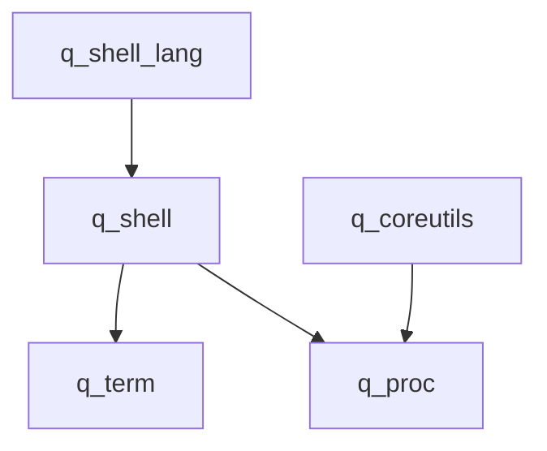

# q_os

## What

A series of crates which emulate the basics of an operating system kernel on top
of bevy_ecs.

## Ontology

Unix runs on files, but it is inaccurate to think about files in an ECS. In ECS,
everything is ontically an entity, but ontologically a bundle of components. In
Unix, an ontic/ontological distinction can be drawn between the process (ontic,
enacted Being-in-the-world) and the program (ontological, the code which defines
it). The filesystem is different though. If the process is the subject, then the
filesystem is the object. Files are what processes act upon. Files are state,
processes are mutation. I find it unlikely that we would want a proper VFS
though, most likely we’d want to read and write from asset state, which comes
built in to Bevy and already acts as a hostfs. -- Perhaps we’re building
something like an ECS-backed microkernel and a native textual interface to that
system?

## Why

I want a familiar way to bundle activities on top of an ECS, to
be able to turn them on and off as needed. A process model and a command line
are the tools I've chosen.

Processes are linear in time.

```
Open process -> Process does something for multiple frames -> Process exits
```

Also, processes have IO, which is nice for semi-isolated systems. Though this is
just messaging and all that. Still, it defines a typed channel through which
different systems can communicate.

Ultimately, the goal is a scripting language. An imperative shell script for
live editing. That's a DSL, baby! qscript probably. No reason this couldn't be
saved to a file, extended, etc.


## Dependency structure



## About the crates

### q_shell_lang

A shell language layer, integrated against the primitives in q_shell. Intended
to be a simple imperative language with query commands.

This is the shell language used for q_os, but third parties are free to
implement their own languages on top of the q_shell primitives. For example,
using a lua or python interpreter is valid.

### q_shell

Shell primitives and integration layer between q_term and q_proc.

### q_coreutils

Core utility programs for q_os. Contents TBD.

### q_term

VT100 terminal emulator built on bevy_ui. Integrates full ANSI parsing and PTY
emulation.

### q_proc

Bevy process model. The key abstraction for the OS interface.
